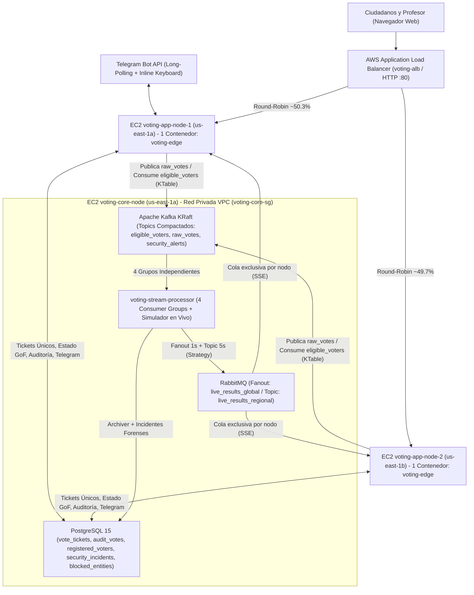
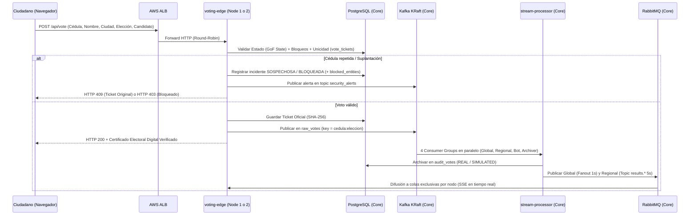

# Informe Técnico Completo — Plataforma Distribuida de Votación de Alta Disponibilidad en AWS

> [!IMPORTANT]
> **Estado del Proyecto:** 100% refactorizado, sin Firebase, con **65/65 pruebas unitarias aisladas en verde**, rediseño UI/UX (`#20B2A6`), mapa electoral en vivo de Colombia, predicción de Segunda Vuelta, integración interactiva bidireccional con Bot de Telegram y **desplegado en producción sobre AWS (`us-east-1`)** detrás de un **AWS Application Load Balancer Multi-AZ**.

---

## 1. URLs en Vivo (Despliegue AWS `us-east-1`)

| Sección | Acceso | URL en Producción |
|---|---|---|
| **Cabina de Votación (Público)** | Ciudadanos | http://voting-alb-2075672195.us-east-1.elb.amazonaws.com/ |
| **Predicción de Segunda Vuelta** | Ciudadanos | http://voting-alb-2075672195.us-east-1.elb.amazonaws.com/prediccion.html |
| **Resultados Nacionales en Vivo** | Ciudadanos | http://voting-alb-2075672195.us-east-1.elb.amazonaws.com/dashboard-global.html |
| **Resultados Regionales + Mapa** | Ciudadanos | http://voting-alb-2075672195.us-east-1.elb.amazonaws.com/dashboard-regional.html |
| **Panel de Administración (Oculto)** | Clic en el logo superior izquierdo | http://voting-alb-2075672195.us-east-1.elb.amazonaws.com/admin.html |

---

## 2. Transformación Arquitectónica (Solución a las Observaciones del Profesor)

### Diagnóstico Inicial vs. Solución Implementada

| Aspecto | Estado Anterior (Rechazado) | Nueva Arquitectura Distribuida (Aprobada) |
|---|---|---|
| **Contenedores y Distribución** | **14 contenedores** apilados en 1 sola máquina, sin balanceo ni réplicas. | **6 contenedores totales** distribuidos en **3 instancias AWS EC2** en **2 Zonas de Disponibilidad (`us-east-1a` y `us-east-1b`)** detrás de **1 AWS Application Load Balancer**. |
| **Balanceo de Carga** | Inexistente (1 solo `voting-api` como punto único de fallo). | **AWS ALB (`voting-alb`)** con algoritmo Round-Robin, Health Check `/api/health` cada 15s y reparto real verificado (**50.3% / 49.7%**). |
| **Apache Kafka** | 3 contenedores (`zookeeper`, `kafka`, `kafka-init`). | **1 contenedor `kafka` en modo KRaft** (sin Zookeeper) + inicialización programática vía `AdminClient` (`KafkaTopicInitializer`). |
| **Autenticación / Firebase** | Pantalla de login con Firebase Auth y Hosting. | **100% eliminado** (sin `.firebaserc`, `firebase.json`, `login.html`, ni scripts de Firebase). Plataforma electoral abierta real. |
| **Votación Ciudadana** | Formulario básico con IDs `voter_001` y sin ticket ni control real de cédula. | Formulario completo con **Cédula**, **Nombre**, **Ciudad** (mapeada a Región) y **Candidato con retrato** para **2 elecciones** (Nacional y Regional). |
| **Unicidad y Ticket** | Permitía repetir votos sin comprobante visual. | **Unicidad atómica en PostgreSQL** (`UNIQUE(voter_id, election_type)`): bloquea duplicados (`HTTP 409`) mostrando el **Ticket Electoral Digital** con código `TKT-...` y sello SHA-256. |
| **Anti-Fraude y Suplantación** | Solo detectaba ráfagas por IP en memoria. | Detecta **ataques Bot**, **duplicados repetidos** y **suplantación de identidad (misma cédula + diferente nombre)** con bloqueo automático (`HTTP 403`) y desbloqueo en Admin. |
| **Administración y Tiempo Real** | Sin consola unificada ni diferenciación real/simulado. | **Panel `/admin.html`** (oculto tras el logo personalizado) con simulador en vivo, diferenciación **REALES vs SIMULADOS**, 5 tablas en vivo, **Mapa Interactivo de Colombia** y **Bot de Telegram bidireccional**. |

---

## 3. Diagrama de Arquitectura Distribuida en AWS



---

## 4. Inventario de Infraestructura Provisionada en AWS (`us-east-1`)

| Recurso AWS | Nombre / ID | Tipo / Zona | IP / DNS | Contenedores | Seguridad |
|---|---|---|---|---|---|
| **Application Load Balancer** | `voting-alb` | Internet-facing IPv4 (`us-east-1a`, `us-east-1b`) | `voting-alb-2075672195.us-east-1.elb.amazonaws.com` | — | `voting-alb-sg` (`sg-07f543d97fcf8c986`): HTTP 80 público |
| **Target Group** | `voting-edge-tg` | Instances HTTP:80 | Health Check: `GET /api/health` (15s) | — | Ambos targets `healthy` |
| **EC2 Core Node** | `voting-core-node` (`i-0622a7cb6db892da8`) | `t3.small` (`us-east-1a`, 20GB gp3 + 2GB swap) | Privada: `172.31.10.234` / Pública: `3.231.153.186` | **4** (`postgres`, `kafka`, `rabbitmq`, `voting-stream-processor`) | `voting-core-sg` (`sg-060f2343a64033418`): puertos 5432, 9092, 5672, 8081 **solo desde VPC `172.31.0.0/16`** |
| **EC2 App Node 1** | `voting-app-node-1` (`i-06e390d952509279d`) | `t3.small` (`us-east-1a`, 20GB gp3 + 2GB swap) | Pública: `3.238.79.53` | **1** (`voting-edge`) | `voting-app-sg` (`sg-080249a9ea08617f6`): HTTP 80, SSH 22 |
| **EC2 App Node 2** | `voting-app-node-2` (`i-0863ef77acb51ba59`) | `t3.small` (`us-east-1b`, 20GB gp3 + 2GB swap) | Pública: `44.201.224.238` | **1** (`voting-edge`) | `voting-app-sg` (`sg-080249a9ea08617f6`): HTTP 80, SSH 22 |

> [!NOTE]
> **Docker Desktop local:** No se requiere ni se está ejecutando en tu PC local; toda la contenerización corre en AWS EC2. No obstante, el archivo [docker-compose.yml](file:///d:/Poo_Operativos/docker-compose.yml) local también quedó optimizado a **7 contenedores** con balanceador Nginx Round-Robin por si se desea demostrar localmente.

---

## 5. Diseño Orientado a Objetos (POO), SOLID y Patrones GoF (Java 17+)

El proyecto Maven multimódulo ([backend/pom.xml](file:///d:/Poo_Operativos/backend/pom.xml)) se consolidó en **3 módulos limpios**:
1. **`common-domain`**: Núcleo de dominio puro (sin acoplamiento a Spring, Kafka, RabbitMQ ni JDBC).
2. **`voting-edge-node`**: Gateway HTTP, validación de elegibilidad KTable, unicidad de tickets, anti-fraude de suplantación, SSE dashboards, mapa, predicción de segunda vuelta, Telegram Bot y frontend estático.
3. **`voting-stream-processor`**: 4 grupos de consumidores Kafka independientes, agregación global/regional, detección de bots, archivado transaccional PostgreSQL y simulador en tiempo real.

### Cumplimiento de Principios POO y Patrones

| Principio / Patrón | Implementación Exacta en el Código | Archivos Clave |
|---|---|---|
| **Java 17+ Records e Inmutabilidad (Fail-Fast)** | Validaciones estrictas en constructores compactos; cero modelos anémicos con setters pasivos. | [VoterId.java](file:///d:/Poo_Operativos/backend/common-domain/src/main/java/com/voting/platform/domain/model/VoterId.java), [City.java](file:///d:/Poo_Operativos/backend/common-domain/src/main/java/com/voting/platform/domain/model/City.java), [VoteTicketCode.java](file:///d:/Poo_Operativos/backend/common-domain/src/main/java/com/voting/platform/domain/model/VoteTicketCode.java), [VoteRecord.java](file:///d:/Poo_Operativos/backend/common-domain/src/main/java/com/voting/platform/domain/model/VoteRecord.java), [VoteTicketRecord.java](file:///d:/Poo_Operativos/backend/common-domain/src/main/java/com/voting/platform/domain/model/VoteTicketRecord.java), [RunoffPredictionRecord.java](file:///d:/Poo_Operativos/backend/common-domain/src/main/java/com/voting/platform/domain/model/RunoffPredictionRecord.java) |
| **Agregados de Dominio Rico** | Protegen invariantes de unicidad, deduplicación por elección (`NACIONAL`/`REGIONAL`), separación `REAL`/`SIMULATED` y cálculo estadístico de balotaje. | [VoteCounterAggregate.java](file:///d:/Poo_Operativos/backend/common-domain/src/main/java/com/voting/platform/domain/aggregate/VoteCounterAggregate.java), [RegionalVoteCounterAggregate.java](file:///d:/Poo_Operativos/backend/common-domain/src/main/java/com/voting/platform/domain/aggregate/RegionalVoteCounterAggregate.java), [BotDetectorAggregate.java](file:///d:/Poo_Operativos/backend/common-domain/src/main/java/com/voting/platform/domain/aggregate/BotDetectorAggregate.java), [RunoffPredictor.java](file:///d:/Poo_Operativos/backend/common-domain/src/main/java/com/voting/platform/domain/aggregate/RunoffPredictor.java) |
| **Patrón GoF Strategy** | Intercambio polimórfico de algoritmos de ponderación electoral regional (`CENTRO x1.40`, `NORTE x1.25`, `SUR x1.15`, `OESTE x1.05`, `ESTE x0.90` vs `UniformWeightingStrategy`). | [RegionalStrategyContext.java](file:///d:/Poo_Operativos/backend/common-domain/src/main/java/com/voting/platform/domain/strategy/RegionalStrategyContext.java), [ElectoralWeightingStrategy.java](file:///d:/Poo_Operativos/backend/common-domain/src/main/java/com/voting/platform/domain/strategy/ElectoralWeightingStrategy.java), [RegionalRollupService.java](file:///d:/Poo_Operativos/backend/voting-stream-processor/src/main/java/com/voting/platform/stream/service/RegionalRollupService.java) |
| **Patrón GoF State (Ciclo Electoral)** | Modela `HABILITADO`, `EN_AUDITORIA` y `CERRADO` sin condicionales anidados; sincronizado en tiempo real entre ambos nodos AWS y controlable desde Admin o Telegram. | [VotingSession.java](file:///d:/Poo_Operativos/backend/common-domain/src/main/java/com/voting/platform/domain/state/lifecycle/VotingSession.java), [VotingGatewayService.java](file:///d:/Poo_Operativos/backend/voting-edge-node/src/main/java/com/voting/platform/edge/service/VotingGatewayService.java) |
| **Patrón GoF State (Riesgo IP Anti-Fraude)** | Transiciones automáticas `NORMAL → SOSPECHOSA → BLOQUEADA` en ventana deslizante + detección de suplantación por nombre diferente. | [IpTracker.java](file:///d:/Poo_Operativos/backend/common-domain/src/main/java/com/voting/platform/domain/state/risk/IpTracker.java), [BotDetectorService.java](file:///d:/Poo_Operativos/backend/voting-stream-processor/src/main/java/com/voting/platform/stream/service/BotDetectorService.java) |
| **Inversión de Dependencias (DIP)** | Inyección estricta por constructor sobre puertos (`VoteEventPublisher`, `VoteTicketRepositoryPort`, `FraudGuardPort`, `NotificationPort`, `ElectionStateRepositoryPort`, etc.). Cero `@Autowired` en campos. | `backend/common-domain/src/main/java/com/voting/platform/domain/port/` |

---

## 6. Arquitectura Híbrida de Mensajería y Persistencia

### Flujo de Datos Completo



### Base de Datos PostgreSQL ([init.sql](file:///d:/Poo_Operativos/infrastructure/postgres/init.sql))
Alojada dentro de la red privada VPC (`voting-core-sg`), contiene 7 tablas:
1. `election_control`: Estado compartido del ciclo electoral (`HABILITADO`/`EN_AUDITORIA`/`CERRADO`), modo censo estricto, parámetros del simulador, configuración de Telegram y `telegram_last_update_id`.
2. `registered_voters`: Padrón electoral maestro sincronizado con Kafka `eligible_voters`.
3. `vote_tickets`: Comprobantes oficiales con restricción `UNIQUE(voter_id, election_type)`.
4. `audit_votes`: Registro forense inmutable de todos los votos (`REAL` y `SIMULATED`), nodo AWS, ciudad, región e IP.
5. `security_incidents`: Incidentes `SOSPECHOSA` y `BLOQUEADA` (ataques Bot, duplicados abusivos, suplantación).
6. `blocked_entities`: IPs y cédulas bloqueadas activamente (con opción de desbloqueo desde Admin).
7. `telegram_activity_log`: Registro en vivo de todas las acciones ejecutadas por el profesor/administrador desde Telegram.

---

## 7. Contenerización Multietapa y Gobernanza de Recursos (SO)

Ambos microservicios Spring Boot utilizan Dockerfiles **Multi-Stage**:
- **Etapa 1 (Builder):** `maven:3.9.6-eclipse-temurin-17-alpine` con `mvn dependency:go-offline` para caché óptima de capas.
- **Etapa 2 (Runtime):** `eclipse-temurin:17-jre-alpine`, usuario sin privilegios (`appuser`), sin Maven ni código fuente, y parámetros JVM subordinados a cgroups:
  ```text
  -XX:+UseContainerSupport -XX:MaxRAMPercentage=75.0 -XX:+ExitOnOutOfMemoryError
  ```

### Límites de Hardware (`deploy.resources.limits`)

| Servicio | Nodo AWS | CPU Limit | RAM Limit |
|---|---|---|---|
| `postgres` | `voting-core-node` | `0.75` | `512M` |
| `kafka` (KRaft) | `voting-core-node` | `1.00` | `1024M` |
| `rabbitmq` | `voting-core-node` | `0.75` | `512M` |
| `voting-stream-processor` | `voting-core-node` | `1.00` | `640M` |
| `voting-edge` (Réplica 1) | `voting-app-node-1` | `1.50` | `1024M` |
| `voting-edge` (Réplica 2) | `voting-app-node-2` | `1.50` | `1024M` |

---

## 8. Suite de Pruebas Unitarias Aisladas (TDD — JUnit 5 + Mockito)

Ejecutadas 100% en memoria RAM (patrón **AAA: Arrange, Act, Assert**), sin levantar Kafka, RabbitMQ ni PostgreSQL:

| Módulo | Clases de Prueba | Tests | Resultado |
|---|---|---|---|
| `common-domain` | `ValueObjectsTest`, `AggregatesTest`, `StrategyPatternTest`, `StatePatternTest`, `RunoffPredictorTest` | **54** | **54/54 PASS** |
| `voting-edge-node` | `VotingGatewayServiceTest` (voto válido + notificación, voto duplicado con ticket, **bloqueo por suplantación**, modo censo estricto, estado `CERRADO` y `EN_AUDITORIA`) | **6** | **6/6 PASS** |
| `voting-stream-processor` | `StreamServicesUnitTest` (separación Real/Simulado y Nacional/Regional, Strategy swap, detección Bot State, Archiver DIP, Registration batch) | **5** | **5/5 PASS** |
| **TOTAL** | — | **65** | **100% VERDE (`BUILD SUCCESS`)** |

---

## 9. Frontend Profesional UI/UX (`#20B2A6`) y Funcionalidades Clave

1. **Identidad Visual:** Paleta centrada en **`#20B2A6`**, tipografía **Plus Jakarta Sans** + **JetBrains Mono** e iconos **Google Material Symbols Rounded** ([styles.css](file:///d:/Poo_Operativos/backend/voting-edge-node/src/main/resources/static/styles.css)).
2. **Candidatos con Retratos Reales:** 4 candidatos Nacionales (`Elena Vargas`, `Mateo Restrepo`, `Camila Mendoza`, `Andrés Salazar`) y 4 candidatos Regionales (`Sofía Herrera`, `Diego Morales`, `Valentina Ríos`, `Sebastián Castro`) en [CandidateCatalog.java](file:///d:/Poo_Operativos/backend/common-domain/src/main/java/com/voting/platform/domain/model/CandidateCatalog.java).
3. **Separación Ciudadano vs. Administrador Oculto:**
   - En las páginas públicas (`/`, `/prediccion.html`, `/dashboard-global.html`, `/dashboard-regional.html`) **no existe enlace ni botón visible** al panel administrador ni a Telegram.
   - El **logo personalizado** ([logo.png](file:///d:/Poo_Operativos/backend/voting-edge-node/src/main/resources/static/assets/logo.png)) en la esquina superior izquierda actúa como **acceso oculto** al hacer clic → abre `/admin.html` con todas las herramientas administrativas.
4. **Mapa Interactivo de Colombia en Tiempo Real ([colombia-map.js](file:///d:/Poo_Operativos/backend/voting-edge-node/src/main/resources/static/colombia-map.js) + [MapController.java](file:///d:/Poo_Operativos/backend/voting-edge-node/src/main/java/com/voting/platform/edge/controller/MapController.java)):**
   - 21 ciudades colombianas distribuidas en las 5 regiones (`CENTRO`, `NORTE`, `SUR`, `OESTE`, `ESTE`).
   - **Color diferencial:** Ciudades con tráfico simulado en **turquesa (`#20B2A6`)**; ciudades donde entra un **voto ciudadano REAL** cambian a **naranja pulsante (`#f97316`)** con tooltip detallado.
5. **Predicción de Segunda Vuelta ([prediccion.html](file:///d:/Poo_Operativos/backend/voting-edge-node/src/main/resources/static/prediccion.html) + [RunoffPredictor.java](file:///d:/Poo_Operativos/backend/common-domain/src/main/java/com/voting/platform/domain/aggregate/RunoffPredictor.java)):**
   - Aplica regla de **50% + 1**, margen de error al **95% de confianza** ($1.96 \sqrt{p(1-p)/n}$), proyección cara a cara de los 2 finalistas y filtro dinámico (**Todos / Solo Reales / Solo Simulados**).
6. **Centro de Control Bot de Telegram Bidireccional ([TelegramNotificationService.java](file:///d:/Poo_Operativos/backend/voting-edge-node/src/main/java/com/voting/platform/edge/service/TelegramNotificationService.java)):**
   - Funciona con **Long-Polling distribuido** (bloqueo `pg_try_advisory_lock` en PostgreSQL para evitar conflictos entre Node 1 y Node 2, sin requerir certificado HTTPS).
   - Comandos y botones interactivos disponibles para el profesor en Telegram:
     - `🏆 Informe 2da Vuelta` (`/segundavuelta`)
     - `⚖️ Distribución Nodos AWS` (`/nodos`)
     - `📊 Resumen En Vivo` (`/resultados`)
     - `⚡ Simular +25 Votos` (`/simular`)
     - `▶️ Activar Simulador` / `⏸️ Pausar Simulador` (`/sim_on`, `/sim_off`)
     - `🛡️ Ataque Bot` (`/bot`)
     - `🟢 HABILITADO` / `🟡 AUDITORÍA` / `🔴 CERRAR` (`/estado_habilitado`, `/estado_auditoria`, `/estado_cerrado`)
     - `🎟️ /ticket <cedula>`
   - **Registro en Vivo en la Card de Telegram (`/admin.html`):** Cada acción ejecutada desde Telegram aparece instantáneamente en pantalla indicando qué hizo el usuario de Telegram y qué nodo AWS lo procesó.

---

## 10. Endpoints REST y SSE Principales

| Método | Ruta | Propósito |
|---|---|---|
| `GET` | `/api/health` | Health Check del AWS ALB (devuelve `nodeId`, `availabilityZone`, `ktableEligibleCount`) |
| `GET` | `/api/catalog` | Catálogo de candidatos (con retratos), 21 ciudades → regiones y estado actual |
| `POST` | `/api/vote` (y `/vote`) | Validación de voto, generación de Ticket SHA-256, bloqueo de duplicados (`409`) y suplantación (`403`) |
| `GET` | `/api/tickets/{cedula}` | Consulta de comprobantes oficiales emitidos a una cédula |
| `GET` | `/api/results/global` y `/stream` | Escrutinio Nacional + Global (REST y SSE 1s desde RabbitMQ Fanout) |
| `GET` | `/api/results/regional` y `/stream` | Escrutinio Regional Ponderado (REST y SSE 5s desde RabbitMQ Topic) |
| `GET` | `/api/map/activity` | Coordenadas y conteos Reales vs Simulados de las 21 ciudades para el mapa |
| `GET` | `/api/prediction/runoff?mode=ALL\|REAL\|SIMULATED` | Proyección estadística de Segunda Vuelta (Top 2 Nacional y Regional) |
| `GET` | `/api/admin/overview`, `/votes`, `/voters`, `/incidents` | Tablas y métricas administrativas consolidadas |
| `POST` | `/api/admin/lifecycle`, `/simulator`, `/simulator/burst` | Control GoF State, velocidad/ráfagas del simulador y ataque Bot |
| `DELETE` | `/api/admin/blocked/{entityKey}` | Desbloquear una IP o cédula bloqueada por anti-fraude |
| `GET/POST` | `/api/telegram/config`, `/test`, `/send-runoff`, `/send-nodes`, `/send-summary`, `/activity`, `/webhook` | Control total de la API del Bot de Telegram y feed en vivo |

---

## 11. Guion Sugerido para tu Exposición ante el Profesor (5 Minutos)

1. **Voto Ciudadano Real (`/`):** Abre la URL pública del AWS ALB. Muestra que el ciudadano solo ve *Cabina de Votación*, *Segunda Vuelta*, *Resultados Nacionales* y *Resultados Regionales* (sin panel admin). Emite un voto real con tu cédula, nombre y ciudad (ej. Pasto) → enseña el **Ticket Electoral Digital** con código y hash SHA-256 y el nodo AWS que lo atendió.
2. **Bloqueo Duplicado y Suplantación:** Intenta votar de nuevo con la misma cédula → muestra que bloquea (`HTTP 409`) devolviendo tu ticket original. Luego intenta votar con esa misma cédula pero **otro nombre** → demuestra cómo el sistema levanta alerta `SOSPECHOSA` y al insistir **bloquea (`HTTP 403`)** por suplantación.
3. **Mapa en Vivo y Segunda Vuelta:** Abre **Resultados Regionales** para mostrar el **Mapa de Colombia** con tu ciudad en **naranja pulsante** (voto real) vs turquesa (simulados) y la ponderación **Strategy**. Luego abre **Segunda Vuelta (`/prediccion.html`)** alternando entre *Todos los Votos* y *Solo Reales*.
4. **Acceso Oculto al Panel de Administración:** Haz clic en **tu logo** arriba a la izquierda para abrir `/admin.html`.
   - Pulsa **"Probar Balanceo (6 req)"** para demostrar el Round-Robin Multi-AZ entre `aws-node-1-us-east-1a` y `aws-node-2-us-east-1b`.
   - Muestra en Tabla 3 cómo tu voto real aparece con etiqueta `REAL` frente a los `SIMULADO`, y en Tabla 5 el bloqueo por suplantación (con botón *Desbloquear*).
5. **Interacción en Vivo del Profesor por Telegram:** En la card **Bot de Telegram**, configura tu Token y Chat ID, pulsa **Enviar Menú / Probar** y pásale tu Telegram al profesor para que él mismo pida el **Informe de Segunda Vuelta**, el **Informe de Nodos AWS**, lance una **Simulación +25** o **Cierre el Control Electoral** — y vean en vivo cómo cada acción suya aparece registrada en la card de Telegram y cambia el estado real en AWS.
