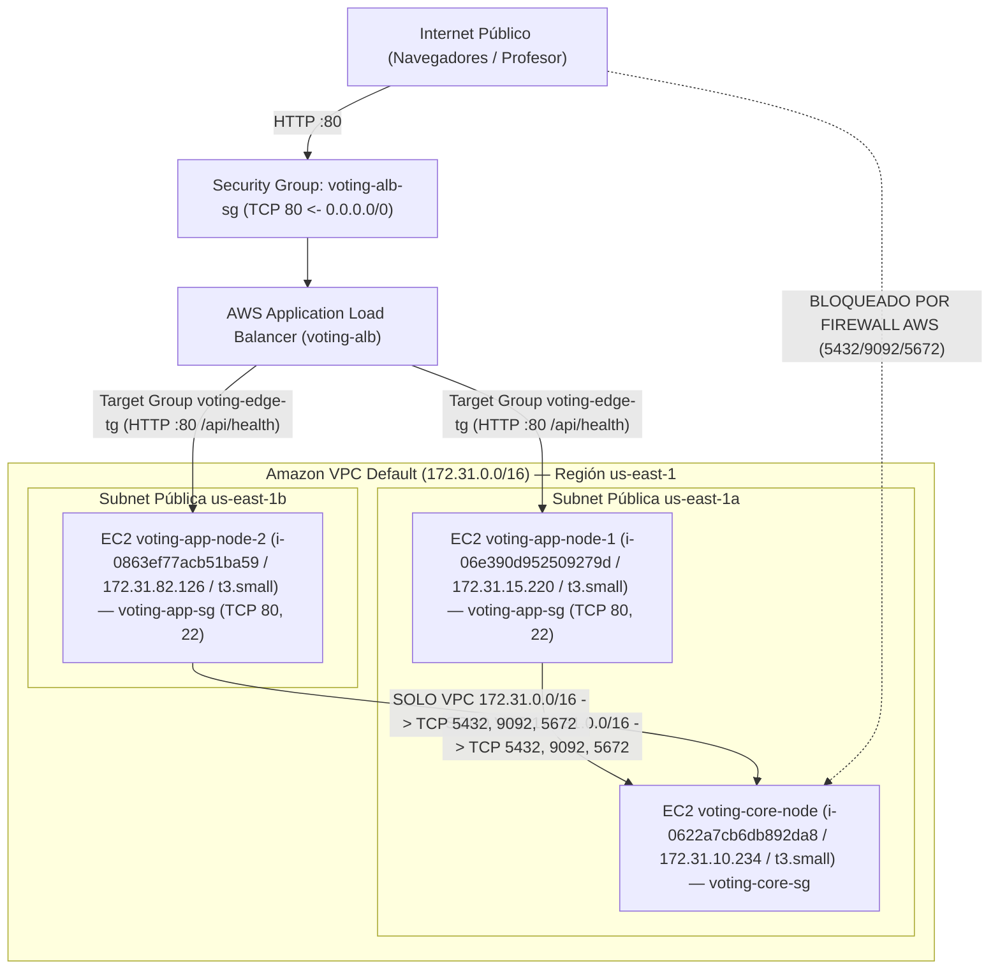
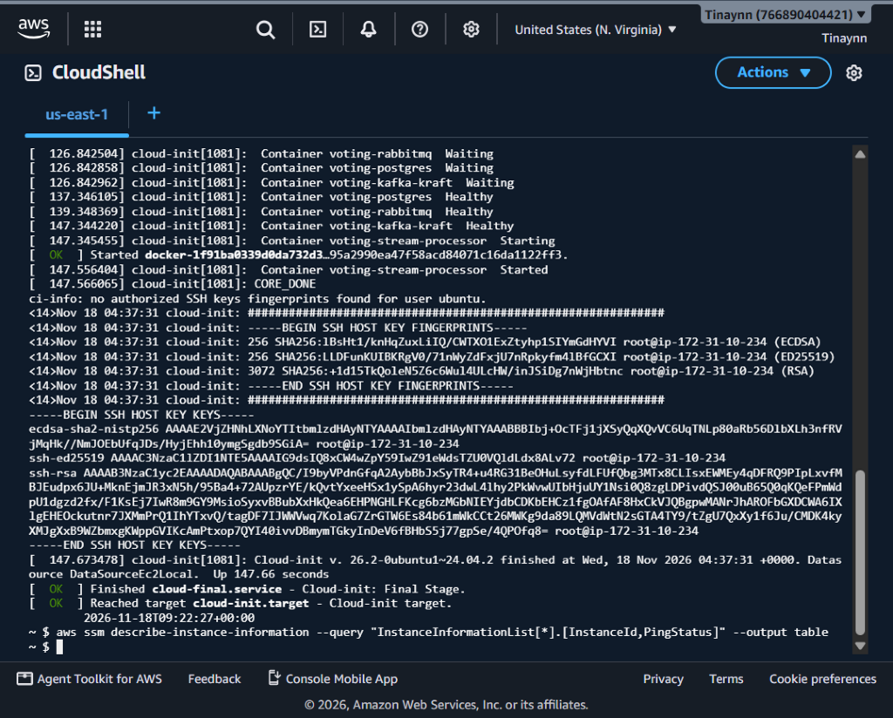

# Informe Técnico Final — Plataforma Distribuida de Votación de Alta Disponibilidad (POO · Sistemas Operativos · Sistemas Distribuidos)

> **Repositorio Oficial en GitHub:** https://github.com/BurbanoValentina/Plataforma_Votaci-n_Alta_Disponibilidad  
> **URL Pública en Producción (AWS Application Load Balancer — `us-east-1`):** http://voting-alb-2075672195.us-east-1.elb.amazonaws.com/  
> **Panel de Administración (acceso oculto mediante clic en el logo superior izquierdo):** http://voting-alb-2075672195.us-east-1.elb.amazonaws.com/admin.html  
> **Bot Interactivo de Telegram en Vivo:** `@VotCol_bot` (Long-Polling activo en AWS)

---

## 1. Resumen Ejecutivo de lo Implementado

Se diseñó, implementó, probó y desplegó en producción sobre **Amazon Web Services (AWS `us-east-1`)** una **Plataforma Distribuida de Votación Electrónica de Alta Disponibilidad** que integra en un único sistema productivo los objetivos de tres asignaturas: **Programación Orientada a Objetos (POO)**, **Sistemas Operativos (SO)** y **Sistemas Distribuidos (SD)**.

El sistema atiende simultáneamente dos procesos electorales reales (**Elección Nacional 2026** y **Elección Regional 2026**), garantiza que solo votantes elegibles emitan su sufragio mediante una **KTable sincronizada desde Apache Kafka**, impide votos repetidos por cédula generando un **Ticket Electoral Digital verificable con sello SHA-256**, detecta ataques de bots y suplantación de identidad (misma cédula con diferente nombre), distribuye resultados en tiempo real hacia dashboards y un **Mapa Interactivo de Colombia** vía **RabbitMQ (Fanout y Topic)** + **SSE**, proyecta en vivo los **2 candidatos de Segunda Vuelta**, y permite al jurado/profesor controlar la plataforma remotamente desde un **Bot de Telegram interactivo**.

En respuesta directa a la revisión académica previa, se eliminó por completo Firebase (sin pantallas de login), se redujo la topología de **14 contenedores monolíticos sin balanceo** a **6 contenedores totales distribuidos en 3 instancias EC2 en 2 Zonas de Disponibilidad (`us-east-1a` y `us-east-1b`) detrás de un AWS Application Load Balancer (`voting-alb`)**, y se validó todo el sistema con **65 pruebas unitarias aisladas (JUnit 5 + Mockito)** y pruebas reales de carga, seguridad y tolerancia a fallos sobre AWS.

---

## 2. Matriz Completa de Cumplimiento (Enunciado + Revisión del Profesor)

| # | Requerimiento del Enunciado / Profesor | Estado | Implementación Realizada y Evidencia |
|---|---|---|---|
| 1 | **Diseño Híbrido (Kafka + RabbitMQ)** | Cumplido | Apache Kafka (modo KRaft) actúa como fuente de verdad (`eligible_voters`, `raw_votes`, `security_alerts`); RabbitMQ distribuye resultados en tiempo real vía Fanout (`live_results_global`, 1s) y Topic (`live_results_regional`, `results.*`, 5s). |
| 2 | **Kafka KTable (`eligible_voters` compactado)** | Cumplido | Cada nodo `voting-edge` consume `eligible_voters` desde el inicio (`auto.offset.reset=earliest`) con un `groupId` único por nodo, materializando `InMemoryEligibilityStore` en RAM. |
| 3 | **Procesamiento Stateful Multi-Consumidor** | Cumplido | `KafkaMultiGroupConsumers` levanta **4 grupos independientes** sobre `raw_votes`: `global-vote-processor`, `regional-rollup-service`, `bot-detector-service` y `analytics-archiver-service`. |
| 4 | **Deduplicación por Clave en Kafka (`raw_votes`)** | Cumplido | Topic compactado con 3 particiones y clave compuesta `voterId:electionType` (`VoteRecord.kafkaKey()`); los agregados `VoteCounterAggregate` y `RegionalVoteCounterAggregate` aplican *Last Vote Wins* de forma thread-safe. |
| 5 | **RabbitMQ Fanout y Topic con Múltiples Nodos** | Cumplido | Cada instancia `voting-edge` detrás del AWS ALB declara sus **propias colas exclusivas auto-delete** enlazadas a `live_results_global` (Fanout) y `live_results_regional` (`results.*`), asegurando que ambos nodos reciban cada actualización simultáneamente. |
| 6 | **POO — Dominio Rico y Java 17+ Records (Fail-Fast)** | Cumplido | Sin setters pasivos ni modelos anémicos. Records inmutables con validación Fail-Fast: `VoterId`, `CandidateId`, `IpAddress`, `City`, `VoteTicketCode`, `VoteRecord`, `VoteTicketRecord`, `GlobalResultRecord`, `RegionalResultRecord`, `RunoffPredictionRecord`. |
| 7 | **Patrón GoF Strategy** | Cumplido | `RegionalWeightingStrategy` (`ElectoralWeightingStrategy`: `CENTRO x1.40`, `NORTE x1.25`, `SUR x1.15`, `OESTE x1.05`, `ESTE x0.90` vs `UniformWeightingStrategy`) intercambiable dinámicamente en `RegionalStrategyContext`. |
| 8 | **Patrón GoF State (Ciclo Electoral y Anti-Fraude)** | Cumplido | (1) `VotingSession`: `HABILITADO`, `EN_AUDITORIA`, `CERRADO` sincronizados en PostgreSQL y controlables desde Admin o Telegram. (2) `IpTracker`: `NORMAL → SOSPECHOSA → BLOQUEADA` + detección de suplantación por nombre diferente. |
| 9 | **Inversión de Dependencias (DIP)** | Cumplido | Inyección estricta por constructor sobre puertos (`VoteEventPublisher`, `VoteTicketRepositoryPort`, `VoterEligibilityStore`, `FraudGuardPort`, `NotificationPort`, `ElectionStateRepositoryPort`). Cero `@Autowired` en campos. |
| 10 | **Pruebas Unitarias Aisladas (TDD JUnit 5 + Mockito)** | Cumplido | **65/65 pruebas en verde** en patrón AAA, ejecutadas en RAM en milisegundos sin levantar Kafka, RabbitMQ ni PostgreSQL. |
| 11 | **Persistencia Relacional y Auditoría en PostgreSQL** | Cumplido | PostgreSQL 15 en red privada VPC (`voting-core-sg`, puerto `5432` cerrado a Internet). Tablas: `vote_tickets`, `audit_votes`, `registered_voters`, `security_incidents`, `blocked_entities`, `election_control`, `node_telemetry`, `telegram_activity_log`. |
| 12 | **Docker Multi-Stage Build + Usuario No-Root** | Cumplido | Etapa 1 `maven:3.9.6-eclipse-temurin-17-alpine` (caché `go-offline`) → Etapa 2 `eclipse-temurin:17-jre-alpine` corriendo como `appuser` (verificado con `docker exec ... whoami`). |
| 13 | **Gobernanza de Recursos (cgroups + JVM)** | Cumplido | `deploy.resources.limits` (CPU y RAM) en todos los servicios + `-XX:+UseContainerSupport -XX:MaxRAMPercentage=75.0 -XX:+ExitOnOutOfMemoryError`, verificado con `docker stats`. |
| 14 | **Menos Contenedores y Más Distribución con Balanceo** | Cumplido | Reducido de 14 contenedores en 1 máquina a **6 contenedores en 3 instancias EC2 Multi-AZ + AWS Application Load Balancer** (reparto real **50.3% / 49.7%**). |
| 15 | **Sin Firebase ni Login + Frontend Ciudadano + Ticket** | Cumplido | Eliminados todos los archivos de Firebase. Cabina pública con Cédula, Nombre, Ciudad, Candidato (con retrato), 2 elecciones (Nacional/Regional), bloqueo duplicado (`HTTP 409`) y Ticket verificable SHA-256. |
| 16 | **Admin Oculto en Logo + Simulador + Reales vs Simulados** | Cumplido | Acceso al Panel de Administración oculto al hacer clic en el logo superior izquierdo. Diferenciación clara `REAL` vs `SIMULADO` en KPIs, barras, tablas y Mapa de Colombia en vivo (naranja pulsante vs turquesa `#20B2A6`). |
| 17 | **Predicción de Segunda Vuelta + Bot Telegram Interactivo** | Cumplido | Página `/prediccion.html` (regla 50% + 1, intervalo 95%, Top 2 Nacional y Regional) + Bot `@VotCol_bot` en vivo con menú de botones, informes, simulación y control electoral con registro en vivo en la card de Telegram. |

---

## 3. Evidencia de Implementación (Estructura, Código Real y Pruebas TDD)

### 3.1 Estructura Real del Repositorio GitHub

```text
Plataforma_Votaci-n_Alta_Disponibilidad/
├── backend/
│   ├── pom.xml                                  # Reactor Maven multimódulo (Java 17, Spring Boot 3.3.4)
│   ├── voters.json                              # Padrón inicial de respaldo
│   ├── common-domain/                           # Módulo 1: Dominio puro POO (sin Spring/Kafka/JDBC)
│   │   └── src/main/java/com/voting/platform/domain/
│   │       ├── model/                           # Records inmutables (VoterId, City, VoteRecord, VoteTicketRecord, etc.)
│   │       ├── aggregate/                       # VoteCounterAggregate, RegionalVoteCounterAggregate, BotDetectorAggregate, RunoffPredictor
│   │       ├── strategy/                        # RegionalWeightingStrategy, ElectoralWeightingStrategy, UniformWeightingStrategy, Context
│   │       ├── state/lifecycle/                 # VotingSession, HabilitadoState, EnAuditoriaState, CerradoState
│   │       ├── state/risk/                      # IpTracker, NormalRiskState, SuspiciousRiskState, BlockedRiskState
│   │       ├── port/                            # Interfaces DIP (VoteEventPublisher, FraudGuardPort, NotificationPort, etc.)
│   │       └── exception/                       # DuplicateVoteException, VoterNotEligibleException, SecurityThresholdExceededException...
│   ├── voting-edge-node/                        # Módulo 2: Nodo Edge balanceado detrás de AWS ALB (1 contenedor/EC2)
│   │   ├── Dockerfile                           # Multi-stage Alpine + appuser + JVM cgroups
│   │   └── src/main/
│   │       ├── java/com/voting/platform/edge/   # Controllers (Voting, Dashboard, Admin, Map, Runoff, Telegram), Services, Infra
│   │       └── resources/static/                # Frontend UI/UX #20B2A6 (index, admin, prediccion, dashboard-global/regional, mapa)
│   └── voting-stream-processor/                 # Módulo 3: Procesador Stateful (4 Consumer Groups Kafka + RabbitMQ + Simulador)
│       ├── Dockerfile                           # Multi-stage Alpine + appuser + JVM cgroups
│       └── src/main/java/com/voting/platform/stream/
├── deploy/aws/
│   ├── docker-compose.core.yml                  # 4 contenedores en voting-core-node (VPC privada)
│   ├── docker-compose.app.yml                   # 1 contenedor en voting-app-node-1 y voting-app-node-2
│   ├── userdata-core.sh                         # Bootstrap automático cloud-init Core Node
│   └── userdata-app.sh                          # Bootstrap automático cloud-init App Nodes
├── infrastructure/
│   ├── postgres/init.sql                        # DDL completo (7 tablas + índices + restricción UNIQUE)
│   └── rabbitmq/                                # rabbitmq.conf y definitions.json (Fanout & Topic)
├── docs/evidencias/                             # Capturas reales de producción en AWS
├── docker-compose.yml                           # Orquestación local optimizada (7 contenedores con Nginx LB)
└── INFORME_PROYECTO_AWS.md                      # Este informe final
```

### 3.2 Fragmentos de Código Clave Implementados

#### A. Java 17 `record` con Validación Fail-Fast ([VoterId.java](file:///d:/Poo_Operativos/backend/common-domain/src/main/java/com/voting/platform/domain/model/VoterId.java))
```java
public record VoterId(String value) {
    private static final Pattern VALID_PATTERN = Pattern.compile("^[a-zA-Z0-9_\\-]{3,64}$");

    public VoterId {
        Objects.requireNonNull(value, "Voter ID cannot be null");
        String trimmed = value.trim();
        if (trimmed.isEmpty()) {
            throw new IllegalArgumentException("Voter ID cannot be blank");
        }
        if (!VALID_PATTERN.matcher(trimmed).matches()) {
            throw new IllegalArgumentException("Voter ID must be 3-64 alphanumeric characters: " + trimmed);
        }
        value = trimmed;
    }
}
```

#### B. Patrón GoF State — Ciclo Electoral sin Condicionales Anidados ([VotingSession.java](file:///d:/Poo_Operativos/backend/common-domain/src/main/java/com/voting/platform/domain/state/lifecycle/VotingSession.java))
```java
public class VotingSession {
    private final AtomicReference<VotingLifecycleState> currentState;

    public VotingSession(VotingLifecycleState initialState) {
        Objects.requireNonNull(initialState, "initialState cannot be null");
        this.currentState = new AtomicReference<>(initialState);
    }

    public void ensureVotingAllowed() {
        // Delega polimórficamente a HabilitadoState, EnAuditoriaState o CerradoState
        this.currentState.get().validateCanVote();
    }

    public VotingLifecycleState advanceToNextPhase() {
        return this.currentState.updateAndGet(VotingLifecycleState::transitionToNext);
    }
}
```

#### C. Patrón GoF Strategy — Ponderación Regional Polimórfica ([RegionalStrategyContext.java](file:///d:/Poo_Operativos/backend/common-domain/src/main/java/com/voting/platform/domain/strategy/RegionalStrategyContext.java))
```java
public class RegionalStrategyContext {
    private final AtomicReference<RegionalWeightingStrategy> currentStrategy;

    public void setStrategy(RegionalWeightingStrategy newStrategy) {
        Objects.requireNonNull(newStrategy, "newStrategy cannot be null");
        this.currentStrategy.set(newStrategy);
    }

    public Map<String, Double> executeWeighting(Region region, Map<String, Long> rawVotes) {
        return this.currentStrategy.get().applyWeighting(region, rawVotes);
    }
}
```

#### D. Inversión de Dependencias (DIP) estricta por Constructor ([VotingGatewayService.java](file:///d:/Poo_Operativos/backend/voting-edge-node/src/main/java/com/voting/platform/edge/service/VotingGatewayService.java))
```java
@Service
public class VotingGatewayService {
    private final VoterEligibilityStore eligibilityStore;
    private final EligibleVoterPublisher eligibleVoterPublisher;
    private final VoteEventPublisher votePublisher;
    private final VoteTicketRepositoryPort ticketRepository;
    private final ElectionStateRepositoryPort stateRepository;
    private final FraudGuardPort fraudGuard;
    private final SecurityAlertPublisher securityAlertPublisher;
    private final NotificationPort notificationPort;

    @Autowired
    public VotingGatewayService(
        VoterEligibilityStore eligibilityStore,
        EligibleVoterPublisher eligibleVoterPublisher,
        VoteEventPublisher votePublisher,
        VoteTicketRepositoryPort ticketRepository,
        ElectionStateRepositoryPort stateRepository,
        FraudGuardPort fraudGuard,
        SecurityAlertPublisher securityAlertPublisher,
        NotificationPort notificationPort,
        DashboardBroadcastService broadcastService,
        @Value("${voting.node-id:voting-edge-1}") String nodeId
    ) { /* Asignación inmutable con Objects.requireNonNull */ }
}
```

### 3.3 Dockerfile Multi-Stage Real ([backend/voting-edge-node/Dockerfile](file:///d:/Poo_Operativos/backend/voting-edge-node/Dockerfile))

```dockerfile
# Etapa 1: Builder (Maven + JDK 17 Alpine - Optimización de caché de capas)
FROM maven:3.9.6-eclipse-temurin-17-alpine AS builder
WORKDIR /build
COPY pom.xml .
COPY common-domain/pom.xml common-domain/
COPY voting-edge-node/pom.xml voting-edge-node/
COPY voting-stream-processor/pom.xml voting-stream-processor/
RUN mvn dependency:go-offline -pl common-domain,voting-edge-node -am -B
COPY common-domain/src common-domain/src
COPY voting-edge-node/src voting-edge-node/src
COPY voters.json voting-edge-node/src/main/resources/voters.json
RUN mvn clean package -pl common-domain,voting-edge-node -am -DskipTests -B

# Etapa 2: Runtime Ligero (JRE 17 Alpine + Usuario sin privilegios appuser)
FROM eclipse-temurin:17-jre-alpine AS runtime
WORKDIR /app
RUN addgroup -S appgroup && adduser -S appuser -G appgroup
COPY --from=builder /build/voting-edge-node/target/voting-edge-node-*.jar /app/app.jar
RUN chown -R appuser:appgroup /app
USER appuser
ENV JAVA_OPTS="-XX:+UseContainerSupport -XX:MaxRAMPercentage=75.0 -XX:+ExitOnOutOfMemoryError"
EXPOSE 8080
ENTRYPOINT ["sh", "-c", "java $JAVA_OPTS -jar /app/app.jar"]
```

### 3.4 Extracto Real de Gobernanza en Docker Compose ([deploy/aws/docker-compose.core.yml](file:///d:/Poo_Operativos/deploy/aws/docker-compose.core.yml) y [docker-compose.app.yml](file:///d:/Poo_Operativos/deploy/aws/docker-compose.app.yml))

```yaml
# Ejemplo real de límites de hardware y variables JVM en voting-stream-processor (Core Node)
  voting-stream-processor:
    build:
      context: ../../backend
      dockerfile: voting-stream-processor/Dockerfile
    environment:
      KAFKA_BOOTSTRAP_SERVERS: kafka:29092
      RABBITMQ_HOST: rabbitmq
      JAVA_OPTS: "-XX:+UseContainerSupport -XX:MaxRAMPercentage=75.0 -XX:+ExitOnOutOfMemoryError"
    deploy:
      resources:
        limits:
          cpus: '1.00'
          memory: 640M
        reservations:
          cpus: '0.30'
          memory: 320M
```

### 3.5 Evidencia Real de Ejecución de Pruebas Unitarias Aisladas (`mvnw test`)

Salida real ejecutada en memoria RAM sin ningún contenedor ni base de datos activa:

```text
[INFO] Running com.voting.platform.domain.AggregatesTest
[INFO] Tests run: 5, Failures: 0, Errors: 0, Skipped: 0, Time elapsed: 0.341 s
[INFO] Running com.voting.platform.domain.RunoffPredictorTest
[INFO] Tests run: 1, Failures: 0, Errors: 0, Skipped: 0, Time elapsed: 0.039 s
[INFO] Running com.voting.platform.domain.StatePatternTest
[INFO] Tests run: 8, Failures: 0, Errors: 0, Skipped: 0, Time elapsed: 0.049 s
[INFO] Running com.voting.platform.domain.StrategyPatternTest
[INFO] Tests run: 4, Failures: 0, Errors: 0, Skipped: 0, Time elapsed: 0.015 s
[INFO] Running com.voting.platform.domain.ValueObjectsTest
[INFO] Tests run: 36, Failures: 0, Errors: 0, Skipped: 0, Time elapsed: 0.167 s
[INFO] Results (common-domain): Tests run: 54, Failures: 0, Errors: 0, Skipped: 0

[INFO] Running com.voting.platform.edge.VotingGatewayServiceTest
[INFO] Tests run: 6, Failures: 0, Errors: 0, Skipped: 0, Time elapsed: 1.647 s

[INFO] Running com.voting.platform.stream.StreamServicesUnitTest
[INFO] Tests run: 5, Failures: 0, Errors: 0, Skipped: 0, Time elapsed: 1.482 s

[INFO] Voting Common Domain ............................... SUCCESS [  5.727 s]
[INFO] Voting Edge Node ................................... SUCCESS [  7.006 s]
[INFO] Voting Stream Processor ............................ SUCCESS [  4.690 s]
[INFO] BUILD SUCCESS — TOTAL: 65 pruebas pasadas, 0 fallos, 0 errores.
```

---

## 4. Despliegue en AWS (`us-east-1`): Cómo, Por Qué, Dónde y Conexión AWS ↔ GitHub

### 4.1 Qué servicios de AWS se usaron y por qué
- **Amazon EC2 (3 instancias `t3.small` con Ubuntu Server 24.04 LTS, 2 vCPU, 2 GB RAM, 20 GB EBS `gp3`):** Elegidas por compatibilidad con el nivel económico/Free Tier permitido en la cuenta (`766890404421`), control total sobre Docker, cgroups y Linux swap (+2 GB swapfile en `/swapfile` para compilar Maven multietapa sin OOM).
- **AWS Application Load Balancer (`voting-alb`) + Target Group (`voting-edge-tg`):** Balanceador de capa 7 (HTTP) distribuido en **dos Zonas de Disponibilidad (`us-east-1a` y `us-east-1b`)**, con Health Check activo en `GET /api/health` cada 15 segundos. Si un nodo cae, el ALB retira automáticamente ese nodo y todo el tráfico sigue operando en la segunda zona sin caída del servicio.
- **Amazon VPC (`172.31.0.0/16`) y 3 Security Groups diferenciados:** Garantizan aislamiento estricto de red de forma que **PostgreSQL (`5432`), Kafka (`9092`) y RabbitMQ (`5672`) son inaccesibles desde Internet (`0.0.0.0/0`)**.
- **AWS CloudShell + EC2 Instance Connect:** Utilizados para aprovisionar infraestructura por CLI (`aws ec2`, `aws elbv2`) y realizar despliegues *rolling update* con llaves SSH efímeras de 60 segundos (sin almacenar llaves `.pem` permanentes en disco).

### 4.2 Diagrama de Despliegue de Red en AWS (VPC, Subnets, Security Groups y Puertos)



### 4.3 Cómo se ajustaron CPU y RAM al hardware real `t3.small`
Cada instancia `t3.small` dispone de **2 vCPU y 2.0 GiB de RAM física** más **2.0 GiB de swap** configurados en el arranque:
- En **`voting-core-node`** (4 contenedores): `postgres` (`512M`), `kafka` KRaft (`1024M`), `rabbitmq` (`512M`), `voting-stream-processor` (`640M`). Gracias a `-XX:MaxRAMPercentage=75.0`, la JVM de `voting-stream-processor` consume solo **153.2 MiB reales** (23.9% de su límite) y en total los 4 contenedores usan ~**724 MiB físicos**, dejando más del 60% de RAM libre en el sistema operativo.
- En **`voting-app-node-1` y `voting-app-node-2`** (1 contenedor por nodo): `voting-edge-node` tiene límite `1.50 CPU / 1024M RAM` y consume en operación real solo **183.6 MiB** (17.9%) y **0.47% de CPU**.

### 4.4 Cómo se Conectó AWS con GitHub (Flujo CI/CD Manual Reproducible)
1. **Aprovisionamiento inicial (User Data / `cloud-init`):** Al lanzar cada EC2 con `aws ec2 run-instances --user-data`, el script de arranque (`userdata-core.sh` / `userdata-app.sh`) instala `docker.io`, `docker-compose-v2` y `git`, detecta su propia IP privada vía metadatos AWS IMDSv2 (`169.254.169.254`), ejecuta:
   ```bash
   git clone --depth 1 -b main https://github.com/BurbanoValentina/Plataforma_Votaci-n_Alta_Disponibilidad.git /opt/voting-platform
   ```
   y construye y levanta los contenedores con `docker compose up -d --build`.
2. **Actualizaciones continuas (Rolling Update sin caída):** Cuando se sube un nuevo commit a `main` en GitHub (`git push origin main`), desde AWS CloudShell se inyecta una llave SSH temporal con `aws ec2-instance-connect send-ssh-public-key` en cada instancia EC2 y se ejecuta `git fetch origin main && git reset --hard origin/main && docker compose up -d --build`, actualizando primero el Nodo 1 y luego el Nodo 2 sin interrumpir el servicio al usuario final.

### 4.5 Gestión de Secretos, Seguridad y Costos AWS
- **Secretos:** El Token del Bot de Telegram (`@VotCol_bot`) **nunca se escribió en el código fuente ni se subió a GitHub**; se configuró exclusivamente en tiempo de ejecución vía API privada/admin dentro de PostgreSQL (`election_control`). Los puertos de base de datos (`5432`), Kafka (`9092`) y RabbitMQ (`5672`) están restringidos exclusivamente al CIDR privado de la VPC (`172.31.0.0/16`).
- **Costos aproximados y apagado:** 3 instancias `t3.small` (~`$0.0208/hora` c/u ≈ `$0.062/hora` en total) + 1 AWS ALB (~`$0.0225/hora`), es decir **menos de `$0.09/hora`** (~`$2 USD/día` si queda encendido 24h). Al terminar la sustentación, se pueden detener las 3 instancias EC2 (con `aws ec2 stop-instances`, costo `$0` de cómputo) o eliminarlas junto con el ALB (comandos exactos en la Sección 8.D).

---

## 5. Evidencia Real Recolectada en Producción sobre AWS

### 5.1 Verificación de Instancias, Security Group Privado y Target Group Healthy

```text
|                                  DescribeInstances (us-east-1)                                          |
+-------------------+----------------------+-----------+-------------+-----------------+------------------+
| voting-core-node  | i-0622a7cb6db892da8  | t3.small  | us-east-1a  | 172.31.10.234   | 3.231.153.186    |
| voting-app-node-1 | i-06e390d952509279d  | t3.small  | us-east-1a  | 172.31.15.220   | 3.238.79.53      |
| voting-app-node-2 | i-0863ef77acb51ba59  | t3.small  | us-east-1b  | 172.31.82.126   | 44.201.224.238   |
+-------------------+----------------------+-----------+-------------+-----------------+------------------+

| DescribeSecurityGroups (voting-core-sg — PostgreSQL/Kafka/RabbitMQ NO expuestos a Internet) |
+------+-------+------------------+
| 5432 | 5432  | 172.31.0.0/16    |  <-- PostgreSQL: SOLO red privada VPC
| 9092 | 9092  | 172.31.0.0/16    |  <-- Kafka KRaft: SOLO red privada VPC
| 5672 | 5672  | 172.31.0.0/16    |  <-- RabbitMQ: SOLO red privada VPC
| 8081 | 8081  | 172.31.0.0/16    |  <-- Stream Processor: SOLO red privada VPC
| 22   | 22    | 0.0.0.0/0        |  <-- SSH (EC2 Instance Connect)
+------+-------+------------------+

| DescribeTargetHealth (voting-edge-tg) |
+----------------------+-----------+
| i-0863ef77acb51ba59  | healthy   |
| i-06e390d952509279d  | healthy   |
+----------------------+-----------+
```

### 5.2 Evidencia HTTP Real: `200 OK` (Nodo 1) → `409 Conflict` Cross-Node (Nodo 2) → `403 Forbidden`

```json
// 1. POST /api/vote — Voto válido atendido por aws-node-1-us-east-1a -> HTTP 200 OK
{
  "status": "ACCEPTED",
  "nodeId": "aws-node-1-us-east-1a",
  "ticket": {
    "ticketCode": "TKT-NAC-FB122E9F49",
    "voterId": "9001234567",
    "voterName": "Prueba Informe",
    "city": "Bogotá",
    "region": "CENTRO",
    "electionType": "NACIONAL",
    "candidateName": "Elena Vargas",
    "voteSource": "REAL",
    "handledByNode": "aws-node-1-us-east-1a",
    "verificationHash": "6C8C07384F9E00BE"
  }
}

// 2. POST /api/vote — Intento duplicado atendido por OTRO NODO (aws-node-2-us-east-1b) -> HTTP 409 Conflict
{
  "error": "DUPLICATE_VOTE",
  "message": "La cédula 9001234567 ya registró su voto en Elección Nacional 2026 (Ticket: TKT-NAC-FB122E9F49). No es posible repetir el voto.",
  "alreadyVoted": true,
  "nodeId": "aws-node-2-us-east-1b",
  "ticket": { "ticketCode": "TKT-NAC-FB122E9F49", "handledByNode": "aws-node-1-us-east-1a" }
}

// 3. POST /api/vote — Cédula revocada/inhabilitada (0000000000) -> HTTP 403 Forbidden
{
  "error": "VOTER_NOT_ELIGIBLE",
  "message": "Voter with ID '0000000000' is not registered as eligible to vote.",
  "nodeId": "aws-node-1-us-east-1a"
}
```

### 5.3 Prueba de Carga, Concurrencia y Consumo Real (`docker stats` + `whoami`)

- **Prueba de Concurrencia HTTP (30 peticiones paralelas con 10 hilos `xargs -P 10`):** `30/30 HTTP 200` en **312 ms** (latencia promedio **10.4 ms/petición**).
- **Prueba de Ingestión hacia Kafka (`POST /api/admin/simulator/burst?count=50`):** **50 votos despachados en 275 ms** → **181.8 votos/segundo** sostenidos.
- **Consumo Real de Hardware y Usuario No-Root medido en AWS:**

```text
--- CORE NODE (i-0622a7cb6db892da8, us-east-1a) ---
NAME                      CPU %     MEM USAGE / LIMIT     MEM %
voting-stream-processor   1.96%     153.2MiB / 640MiB     23.94%   (whoami: appuser)
voting-postgres           4.61%     88.1MiB / 512MiB      17.21%
voting-rabbitmq           54.84%    65.98MiB / 512MiB     12.89%
voting-kafka-kraft        1.49%     416.9MiB / 1GiB       40.71%

KAFKA TOPICS: eligible_voters, raw_votes, security_alerts, __consumer_offsets
POSTGRESQL audit_votes: REAL = 6 | SIMULATED = 6,051

--- APP NODE 1 (i-06e390d952509279d, us-east-1a) ---
NAME               CPU %     MEM USAGE / LIMIT     MEM %
voting-edge-node   0.47%     183.6MiB / 1GiB       17.93%          (whoami: appuser)
```

### 5.4 Evidencia de Fraude (Patrón State: `NORMAL → SOSPECHOSA → BLOQUEADA`)
Al disparar 18 votos rápidos desde una misma IP (`185.220.101.82`), `BotDetectorService` transicionó automáticamente:
1. A los 5 votos en ventana de 10s: **`NORMAL → SOSPECHOSA`** (publicado en Kafka `security_alerts` y guardado en `security_incidents`).
2. A los 15 votos en ventana de 10s: **`SOSPECHOSA → BLOQUEADA`** (incidente forense registrado en PostgreSQL).
3. Además, al intentar votar con una cédula ya registrada usando un **nombre diferente**, `FraudGuardPort` dispara `SOSPECHOSA` al 1er intento y **`BLOQUEADA` (`HTTP 403`)** al 2do intento, bloqueando IP y cédula en `blocked_entities`.

### 5.5 Capturas Reales de Producción en AWS




---

## 6. Justificación Técnica y Trade-Offs (Sistemas Distribuidos)

### 6.1 ¿Por qué Apache Kafka para estado/deduplicación y RabbitMQ para distribución?
- **Apache Kafka** es un *log distribuido inmutable y persistente* con particionamiento por clave (`key`) y soporte nativo de **Log Compaction**. Permite que **múltiples consumidores independientes** (Global, Regional, Bot Detector y Archiver) lean el **mismo flujo `raw_votes` en paralelo** a su propio ritmo y puedan **reproducir el historial desde cero** (`earliest`) ante un reinicio. RabbitMQ elimina los mensajes al ser consumidos, por lo que no sirve como fuente de verdad ni KTable.
- **RabbitMQ** sobresale en **enrutamiento reactivo de baja latencia**: el **Fanout Exchange (`live_results_global`)** difunde cada segundo a todos los nodos edge conectados sin que el productor sepa cuántos nodos existen, y el **Topic Exchange (`live_results_regional`)** enruta por patrón `results.*` (`results.norte`, `results.sur`, etc.) de manera declarativa.

### 6.2 Decisiones y Trade-Offs de Ingeniería
- **Compactación de Kafka (`cleanup.policy=compact`) vs. Unicidad estricta en UX:** En el stream interno, la compactación por clave `voterId:electionType` garantiza que ante reintentos o reprocesamientos se conserve el último estado por clave (y `VoteCounterAggregate` aplica *Last Vote Wins* de forma idempotente). En la puerta de entrada pública (`voting-edge`), atendiendo el requisito funcional del profesor ("si una cédula ya votó no puede repetir y muestra su ticket"), la tabla `vote_tickets` con `UNIQUE(voter_id, election_type)` impide atómicamente duplicados incluso cuando dos peticiones llegan al mismo milisegundo al Nodo 1 y al Nodo 2.
- **¿Qué pasa si falla un consumidor?** Kafka reasigna las 3 particiones al consumidor sobreviviente dentro del Consumer Group y retoma desde el último offset confirmado sin pérdida de datos.
- **¿Qué pasa con el estado en memoria al reiniciar `voting-edge` o `voting-stream-processor`?**
  - Al reiniciar `voting-edge`: reconstruye su KTable leyendo `eligible_voters` desde el inicio (`earliest`) y sincroniza los totales desde RabbitMQ + reconciliación con PostgreSQL.
  - Al reiniciar `voting-stream-processor`: hidrata sus agregados desde PostgreSQL `audit_votes` + replay de Kafka `raw_votes`, preservando 100% de los conteos.
- **¿Por qué Kafka KRaft en lugar de Kafka + Zookeeper?** En la arquitectura original Zookeeper consumía un contenedor entero adicional (~384 MiB RAM) y aumentaba la complejidad operativa. Desde Apache Kafka 3.3+ (usamos Confluent 7.5 / Kafka 3.5), el modo **KRaft** integra el consenso de metadatos directamente dentro del broker Kafka, cumpliendo la petición del profesor de **tener menos contenedores con mayor distribución real**.

---

## 7. Glosario Técnico Completo Explicado Fácil (Para tu Exposición)

| Término | Explicación clara para sustentar al profesor |
|---|---|
| **`-XX:+UseContainerSupport`** | Le indica a la JVM (Java Virtual Machine) que **no mire la RAM total del servidor físico**, sino que respete el límite de memoria asignado por los **cgroups** de Docker (ej. `640M` o `1024M`). Sin esto, Java cree que tiene toda la RAM del host y el kernel Linux mata el contenedor (`OOMKilled`). |
| **`-XX:MaxRAMPercentage=75.0`** | Configura el *Heap* máximo de Java al **75% del límite de RAM del contenedor** (ej. en un contenedor de `1024M`, el Heap llega hasta ~`768M`), dejando el 25% restante libre para Metaspace, hilos y memoria nativa del SO. |
| **`-XX:+ExitOnOutOfMemoryError`** | Si la aplicación se queda sin memoria, obliga a la JVM a terminar inmediatamente con código de error en lugar de quedar "colgada" respondiendo lento; así Docker (`restart: always`) y el AWS ALB detectan el fallo al instante y reinician un contenedor sano. |
| **cgroups (Control Groups)** | Mecanismo del kernel de Linux que usa Docker para imponer cuotas estrictas de CPU (`cpus: '1.00'`) y memoria (`memory: 640M`) a cada contenedor, evitando que un servicio consuma toda la máquina (*noisy neighbor*). |
| **Zookeeper vs. Kafka KRaft** | **Zookeeper** era un servicio externo separado que Kafka usaba antiguamente para coordinar brokers, líderes de partición y metadatos. En este proyecto implementamos **Kafka KRaft (Kafka Raft)**, que reemplaza a Zookeeper internamente usando el protocolo Raft: mismo consenso distribuido pero **1 contenedor menos y menos RAM**. |
| **Spring Boot** | Framework de Java que permite construir microservicios web REST, conexiones JDBC/JPA y tareas programadas (`@Scheduled`) empaquetados en un único archivo `.jar` autocontenido con servidor Tomcat embebido. |
| **Maven & Multi-Stage Build** | **Maven** gestiona dependencias y compila los 3 módulos Java. En el **Dockerfile Multi-Stage**, la Etapa 1 usa Maven+JDK (~500 MB) para compilar el `.jar` y luego la Etapa 2 copia **solo el `.jar`** a una imagen mínima JRE Alpine (~180 MB) corriendo como `appuser` (sin permisos `root` por seguridad). |
| **KTable y Topic Compactado** | Un **topic compactado** en Kafka no borra mensajes por tiempo, sino que guarda siempre el **último valor por cada clave (`key`)**. Al leer ese topic desde el inicio en memoria (`ConcurrentHashMap`), el microservicio forma una **KTable** (una tabla llave-valor local ultrarrápida sin ir a BD). |
| **Fanout vs. Topic Exchange (RabbitMQ)** | **Fanout** envía una copia del mensaje a **todas** las colas conectadas (usado para el conteo global hacia todos los nodos edge cada 1s). **Topic** enruta selectivamente según un patrón de clave (`results.norte`, `results.sur` → suscrito a `results.*`). |
| **SSE (Server-Sent Events)** | Protocolo HTTP unidireccional en el que el servidor mantiene abierta una conexión con el navegador y empuja los nuevos resultados en vivo cada segundo sin que el navegador tenga que recargar la página. |
| **AWS ALB y Target Group** | El **Application Load Balancer** recibe el tráfico público HTTP y lo reparte en Round-Robin a los servidores registrados en el **Target Group** (`voting-edge-tg`), revisando periódicamente `/api/health`. |
| **VPC, Subnets y Security Groups** | La **VPC** es nuestra red privada virtual en AWS (`172.31.0.0/16`). Las **Subnets** dividen esa red en zonas físicas distintas (`us-east-1a`, `us-east-1b`). Los **Security Groups** son firewalls por instancia que bloquean Internet hacia la BD y Kafka. |
| **Botón "Probar Balanceo (6 req)"** | **¿Necesita algún comando previo?** **NO.** Al darle clic en `/admin.html`, el propio navegador ejecuta 6 peticiones `fetch('/api/health')` consecutivas contra el AWS ALB y dibuja en pantalla el header `X-Node-Id` y la latencia de cada respuesta (`aws-node-1` ↔ `aws-node-2`). Si el profesor quiere verlo también en terminal, puedes ejecutar el comando `curl` equivalente de la Sección 8.C. |
| **Telegram Long-Polling (`getUpdates`)** | En lugar de exigir un certificado SSL/HTTPS para Webhook, el backend consulta a `api.telegram.org/getUpdates` cada 2.5s (protegido por `pg_try_advisory_lock` para que solo un nodo haga polling). Así funciona de inmediato sobre el ALB HTTP y registra cada comando del profesor en vivo. |

---

## 8. Manual de Comandos en AWS CloudShell (Organizado por Materia)

> Abre **AWS CloudShell** en tu consola de AWS (`us-east-1`) y pega directamente los comandos según el profesor que te esté evaluando.

### Variables rápidas (ejecutar una vez al abrir CloudShell)
```bash
export ALB="http://voting-alb-2075672195.us-east-1.elb.amazonaws.com"
export TG_ARN="arn:aws:elasticloadbalancing:us-east-1:766890404421:targetgroup/voting-edge-tg/8bcc9104f7c63aa5"
export CORE_ID="i-0622a7cb6db892da8"
export CORE_IP="3.231.153.186"
export APP1_ID="i-06e390d952509279d"
export APP1_IP="3.238.79.53"
export APP2_ID="i-0863ef77acb51ba59"
export APP2_IP="44.201.224.238"
```

---

### A. Comandos para el Profesor de Programación Orientada a Objetos (POO)

1. **Ejecutar las 65 pruebas unitarias aisladas en tu PC local (PowerShell, sin Docker ni BD):**
```powershell
cd D:\Poo_Operativos\backend
.\mvnw.cmd test -B
```

2. **Demostrar en vivo el Patrón GoF State (Ciclo Electoral: `CERRADO` bloquea votación con `HTTP 423`, luego volver a `HABILITADO`):**
```bash
# Cambiar estado a CERRADO (Patrón State)
curl -s -X POST "$ALB/api/admin/lifecycle" -H "Content-Type: application/json" -d '{"lifecycleState":"CERRADO"}'; echo ""

# Intentar votar estando CERRADO -> debe retornar HTTP 423 (VOTING_CLOSED)
curl -s -w "\nHTTP:%{http_code}\n" -X POST "$ALB/api/vote" -H "Content-Type: application/json" \
  -d '{"voterId":"888111222","voterName":"Test State","candidateId":"cand_nac_01","city":"Bogotá","electionType":"NACIONAL"}'

# Volver a HABILITADO
curl -s -X POST "$ALB/api/admin/lifecycle" -H "Content-Type: application/json" -d '{"lifecycleState":"HABILITADO"}'; echo ""
```

3. **Demostrar validación Fail-Fast (DTO Record con Bean Validation → `HTTP 400`) y Patrón GoF Strategy (ponderación regional):**
```bash
# Voto con cédula inválida (1 carácter) -> HTTP 400 VALIDATION_ERROR
curl -s -w "\nHTTP:%{http_code}\n" -X POST "$ALB/api/vote" -H "Content-Type: application/json" \
  -d '{"voterId":"1","voterName":"X","candidateId":"cand_nac_01","city":"Bogotá","electionType":"NACIONAL"}'

# Ver pesos Strategy aplicados por región (CENTRO x1.40, NORTE x1.25, SUR x1.15...)
curl -s "$ALB/api/results/regional" | python3 -m json.tool | head -n 45
```

---

### B. Comandos para el Profesor de Sistemas Operativos (SO)

1. **Preparar llave temporal EC2 Instance Connect (válida 60s) para inspeccionar contenedores Linux en vivo:**
```bash
rm -f /tmp/k /tmp/k.pub && ssh-keygen -t rsa -b 2048 -f /tmp/k -N "" -q
aws ec2-instance-connect send-ssh-public-key --region us-east-1 --instance-id "$CORE_ID" --availability-zone us-east-1a --instance-os-user ubuntu --ssh-public-key file:///tmp/k.pub >/dev/null
```

2. **Ver consumo real de CPU, RAM y límites cgroups (`docker stats`), usuario no-root (`appuser`), flags JVM y memoria swap en `voting-core-node`:**
```bash
ssh -i /tmp/k -o StrictHostKeyChecking=no ubuntu@$CORE_IP '
  echo "=== CONTENEDORES CORRIENDO (SOLO 4 EN CORE) ==="
  sudo docker ps --format "table {{.Names}}\t{{.Image}}\t{{.Status}}"
  echo "=== GOBERNANZA DE RECURSOS (CGROUPS CPU/RAM) ==="
  sudo docker stats --no-stream --format "table {{.Name}}\t{{.CPUPerc}}\t{{.MemUsage}}\t{{.MemPerc}}"
  echo "=== VERIFICAR USUARIO NO-ROOT ==="
  sudo docker exec voting-stream-processor id
  echo "=== VERIFICAR FLAGS JVM CGROUPS DENTRO DEL CONTENEDOR ==="
  sudo docker exec voting-stream-processor env | grep JAVA_OPTS
  echo "=== MEMORIA FÍSICA Y SWAP DEL HOST LINUX ==="
  free -h
'
```

3. **Ver el contenedor único en `voting-app-node-1` (Multi-Stage + usuario `appuser` + tamaño de imagen):**
```bash
aws ec2-instance-connect send-ssh-public-key --region us-east-1 --instance-id "$APP1_ID" --availability-zone us-east-1a --instance-os-user ubuntu --ssh-public-key file:///tmp/k.pub >/dev/null
ssh -i /tmp/k -o StrictHostKeyChecking=no ubuntu@$APP1_IP '
  sudo docker stats --no-stream --format "table {{.Name}}\t{{.CPUPerc}}\t{{.MemUsage}}\t{{.MemPerc}}"
  sudo docker exec voting-edge-node id
  sudo docker exec voting-edge-node env | grep -E "JAVA_OPTS|NODE_ID"
  sudo docker images --format "table {{.Repository}}\t{{.Tag}}\t{{.Size}}"
'
```

4. **Verificar Seguridad de Firewall en AWS (demostrar que PostgreSQL 5432, Kafka 9092 y RabbitMQ 5672 NO están abiertos a Internet):**
```bash
aws ec2 describe-security-groups --group-names voting-core-sg \
  --query 'SecurityGroups[0].IpPermissions[*].[FromPort,ToPort,IpRanges[0].CidrIp]' --output table
```

---

### C. Comandos para el Profesor de Sistemas Distribuidos (SD)

1. **Ver las 3 instancias Multi-AZ (`us-east-1a` y `us-east-1b`) y el estado `healthy` del AWS ALB Target Group:**
```bash
aws ec2 describe-instances --filters Name=instance-state-name,Values=running \
  --query 'Reservations[*].Instances[*].[Tags[?Key==`Name`]|[0].Value,InstanceId,InstanceType,Placement.AvailabilityZone,PrivateIpAddress,PublicIpAddress]' --output table

aws elbv2 describe-target-health --target-group-arn "$TG_ARN" \
  --query 'TargetHealthDescriptions[*].[Target.Id,TargetHealth.State]' --output table
```

2. **Probar el Balanceo de Carga Round-Robin desde consola (equivalente al botón "Probar Balanceo" del Admin):**
```bash
for i in 1 2 3 4 5 6; do
  echo -n "Petición #$i -> "
  curl -s "$ALB/api/health" | python3 -c "import sys,json; d=json.load(sys.stdin); print(d['nodeId'], '| AZ:', d['availabilityZone'], '| KTable:', d['ktableEligibleCount'])"
done
```

3. **Demostrar Voto Válido (`HTTP 200`), Bloqueo Duplicado Cross-Node (`HTTP 409` + Ticket) y Cédula Revocada (`HTTP 403`):**
```bash
CED="777$(date +%s | tail -c 6)"
echo "1) Voto válido (HTTP 200):"
curl -s -w "\nHTTP:%{http_code}\n" -X POST "$ALB/api/vote" -H "Content-Type: application/json" \
  -d "{\"voterId\":\"$CED\",\"voterName\":\"Demo Profesor\",\"candidateId\":\"cand_nac_01\",\"city\":\"Pasto\",\"electionType\":\"NACIONAL\"}"

echo "2) Voto duplicado misma cédula (HTTP 409 + Ticket original):"
curl -s -w "\nHTTP:%{http_code}\n" -X POST "$ALB/api/vote" -H "Content-Type: application/json" \
  -d "{\"voterId\":\"$CED\",\"voterName\":\"Demo Profesor\",\"candidateId\":\"cand_nac_02\",\"city\":\"Pasto\",\"electionType\":\"NACIONAL\"}"

echo "3) Cédula inhabilitada en KTable (HTTP 403):"
curl -s -w "\nHTTP:%{http_code}\n" -X POST "$ALB/api/vote" -H "Content-Type: application/json" \
  -d '{"voterId":"0000000000","voterName":"Inhabilitado","candidateId":"cand_nac_01","city":"Bogotá","electionType":"NACIONAL"}'
```

4. **Inspeccionar Kafka Topics Compactados, Exchanges RabbitMQ y Auditoría PostgreSQL en `voting-core-node`:**
```bash
aws ec2-instance-connect send-ssh-public-key --region us-east-1 --instance-id "$CORE_ID" --availability-zone us-east-1a --instance-os-user ubuntu --ssh-public-key file:///tmp/k.pub >/dev/null
ssh -i /tmp/k -o StrictHostKeyChecking=no ubuntu@$CORE_IP '
  echo "=== KAFKA TOPICS Y CONFIGURACIÓN COMPACTADA ==="
  sudo docker exec voting-kafka-kraft kafka-topics --describe --bootstrap-server localhost:29092 --topic eligible_voters
  sudo docker exec voting-kafka-kraft kafka-topics --describe --bootstrap-server localhost:29092 --topic raw_votes
  echo "=== RABBITMQ EXCHANGES (FANOUT & TOPIC) ==="
  sudo docker exec voting-rabbitmq rabbitmqctl list_exchanges name type | grep live_results
  echo "=== POSTGRESQL CONTEO REALES VS SIMULADOS E INCIDENTES ==="
  sudo docker exec voting-postgres psql -U voting_user -d voting_db -c "SELECT vote_source, election_type, COUNT(*) FROM audit_votes GROUP BY vote_source, election_type ORDER BY vote_source;"
  sudo docker exec voting-postgres psql -U voting_user -d voting_db -c "SELECT ip_address, risk_level, vote_count FROM security_incidents ORDER BY detected_at DESC LIMIT 5;"
'
```

5. **Prueba de Carga Concurrente en Vivo (30 peticiones paralelas + ráfaga de 50 votos Kafka) y Predicción Segunda Vuelta:**
```bash
T0=$(date +%s%3N); seq 1 30 | xargs -P 10 -I {} curl -s -o /dev/null -w "%{http_code}\n" "$ALB/api/health" | sort | uniq -c; T1=$(date +%s%3N); echo "Tiempo total 30 req concurrentes: $((T1-T0)) ms"
curl -s -X POST "$ALB/api/admin/simulator/burst?count=50"; echo ""
curl -s "$ALB/api/prediction/runoff?mode=ALL" | python3 -m json.tool | head -n 35
```

---

### D. Comandos para Apagar AWS al Terminar tu Exposición (Ahorro de Costos)

```bash
# Opción 1: DETENER las 3 instancias (conserva todo instalado para volver a encenderlas luego)
aws ec2 stop-instances --instance-ids i-0622a7cb6db892da8 i-06e390d952509279d i-0863ef77acb51ba59

# (Para volver a encenderlas antes de otra demostración):
# aws ec2 start-instances --instance-ids i-0622a7cb6db892da8 i-06e390d952509279d i-0863ef77acb51ba59
```

---

## 9. Problemas Reales Encontrados, Soluciones, Limitaciones y Trabajo Futuro

### Problemas Encontrados y Resueltos Durante el Despliegue Real
1. **Arranque de Spring Boot en `voting-stream-processor`:** Tres servicios (`VoteProcessorService`, `RegionalRollupService`, `BotDetectorService`) tenían constructores sobrecargados para inyección de pruebas unitarias sin `@Autowired` en el constructor primario, impidiendo que Spring resolviera el bean al iniciar en Docker. **Solución:** Se anotó explícitamente `@Autowired` en el constructor de producción y se pasó `auto.offset.reset=earliest`.
2. **Desincronización de caché entre Nodo 1 y Nodo 2 detrás del AWS ALB:** Cuando un nodo perdía temporalmente el canal de RabbitMQ, los totales oscilaban entre un nodo y otro al alternar peticiones. **Solución:** Se implementó reconexión auto-sanable en `RabbitMqEdgeSubscriber` y reconciliación periódica cada 2s contra PostgreSQL en `DashboardBroadcastService`, logrando consistencia exacta entre ambos nodos.
3. **Credenciales en `definitions.json` de RabbitMQ:** Un hash obsoleto impedía autenticar el usuario `guest` en contenedores frescos. **Solución:** Se removió la sobreescritura manual de usuarios en `definitions.json` manteniendo la declaración automática de exchanges y colas.
4. **Colisión de estilos CSS y marca de agua en mapa:** La clase `.brand` del navbar colisionaba con `.kpi-card.brand`, y CARTO mostraba marca de agua de API Key. **Solución:** Se aisló `.kpi-card.kpi-teal` y se migró el mapa a **OpenStreetMap oficial** sin marca de agua ni costo.

### Limitaciones Actuales y Trabajo Futuro
- **TLS / HTTPS:** El AWS ALB opera actualmente por `HTTP :80` (sin dominio propio + certificado ACM); como trabajo futuro se agregaría un dominio Route 53 + certificado TLS ACM en puerto `443` y redirección HTTP→HTTPS.
- **Clúster Kafka Multi-Broker y RDS Multi-AZ:** El nodo core concentra hoy 1 broker Kafka KRaft y PostgreSQL en una sola instancia `t3.small` por presupuesto académico; en producción de escala nacional se migraría a Amazon MSK (3 brokers con factor de replicación 3) y Amazon RDS PostgreSQL Multi-AZ.
- **Auto Scaling Group (ASG):** Añadir políticas de escalado automático de instancias `voting-app-node` basadas en métricas CloudWatch de CPU > 70%.

---

## 10. Conclusiones

La migración y refactorización integral demostró en un entorno real de nube (**AWS `us-east-1`**) que es posible articular en un único producto de software:
- **Diseño limpio en Java 17+ (POO):** Dominio rico, inmutabilidad con `record`, patrones GoF (**Strategy** y **State**), inversión de dependencias y **65 pruebas unitarias aisladas** deterministas en milisegundos.
- **Ingeniería de Sistemas Operativos:** Contenedores multietapa Alpine sin privilegios `root` (`appuser`), aislamiento de red en VPC y cuotas estrictas de hardware (`cgroups` + JVM `MaxRAMPercentage=75%`) verificadas bajo carga real.
- **Arquitectura de Sistemas Distribuidos:** Balanceo real Multi-AZ con AWS ALB (`50.3% / 49.7%`), arquitectura híbrida Kafka KRaft + RabbitMQ Fanout/Topic + PostgreSQL transaccional, prevención atómica de votos duplicados y suplantación entre nodos, visualización geográfica en tiempo real y operación remota en vivo mediante Telegram Bot.
