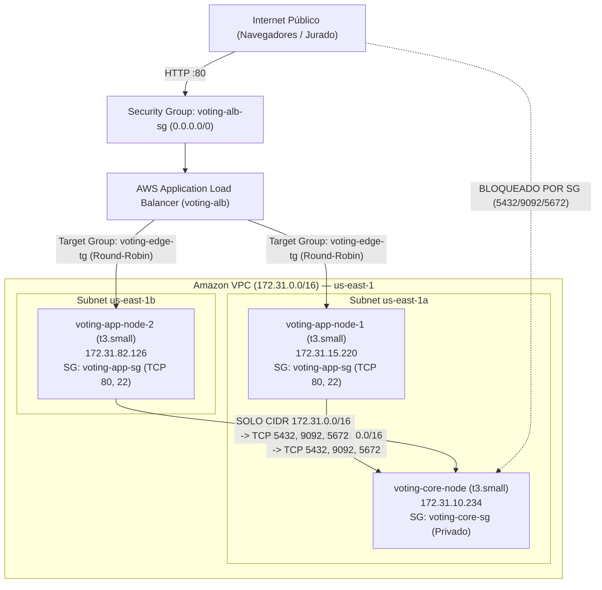
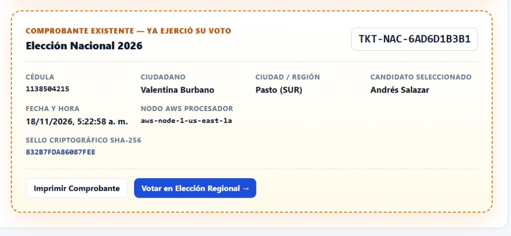
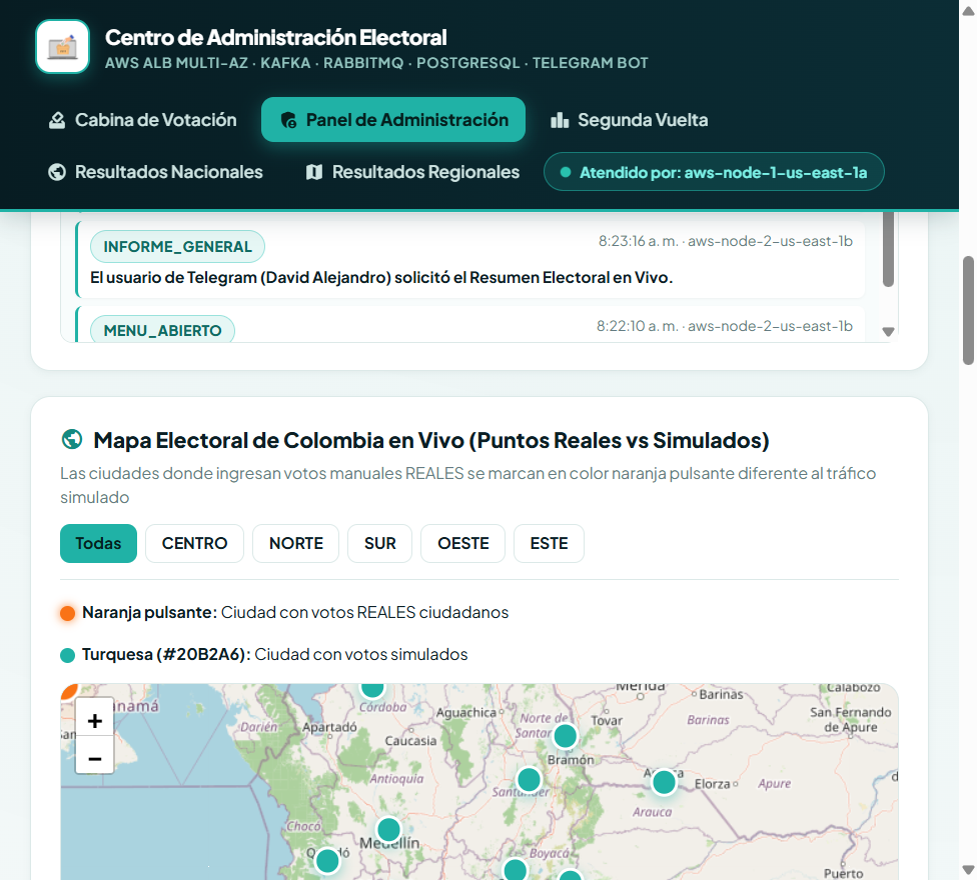
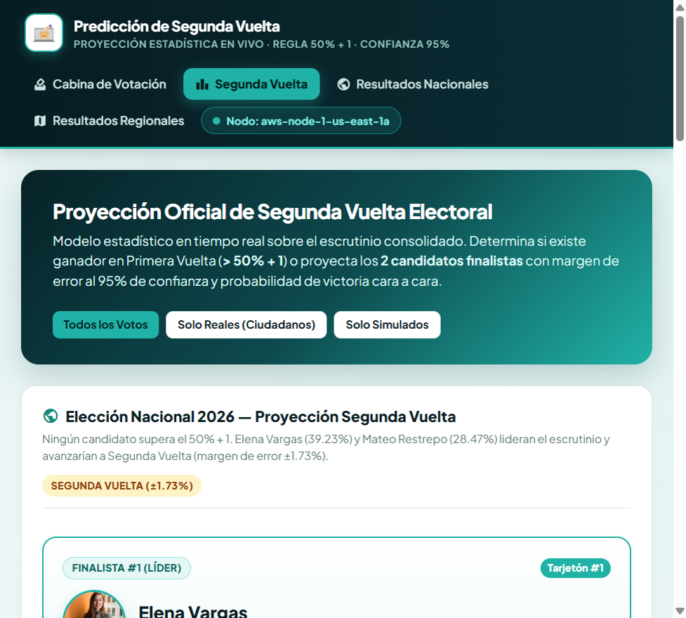

# Informe Técnico Final — Plataforma Distribuida de Votación de Alta Disponibilidad
## Evaluación Académica Integrada: Programación Orientada a Objetos · Sistemas Operativos · Sistemas Distribuidos

> **Repositorio Oficial en GitHub:** [https://github.com/BurbanoValentina/Plataforma_Votaci-n_Alta_Disponibilidad](https://github.com/BurbanoValentina/Plataforma_Votaci-n_Alta_Disponibilidad)  
> **URL Pública en Producción (AWS Application Load Balancer — `us-east-1`):** [http://voting-alb-2075672195.us-east-1.elb.amazonaws.com/](http://voting-alb-2075672195.us-east-1.elb.amazonaws.com/)  
> **Panel de Administración Protegido:** [http://voting-alb-2075672195.us-east-1.elb.amazonaws.com/admin.html](http://voting-alb-2075672195.us-east-1.elb.amazonaws.com/admin.html)  
> **Credenciales Institucionales de Administración:** Usuario: `votacionesR&N@gmail.com` | Contraseña: `admin12345`  
> **Bot Interactivo de Telegram en Vivo:** `@VotCol_bot` (Long-Polling bidireccional activo en AWS)  
> **Estado de Pruebas Unitarias:** 65/65 pruebas pasadas (100% verde en memoria sin dependencias externas)

---

## 1. Resumen Ejecutivo de la Arquitectura Implementada

Se diseñó, implementó, probó exhaustivamente y desplegó en producción sobre la nube de **Amazon Web Services (AWS `us-east-1`)** una **Plataforma Distribuida de Votación Electrónica de Alta Disponibilidad**. El proyecto materializa en un único sistema productivo y desacoplado los requisitos de tres áreas fundamentales de la ingeniería informática:

1. **Programación Orientada a Objetos (POO):** Dominio rico en Java 17 con inmutabilidad mediante `record`, validación defensiva *Fail-Fast*, inversión de dependencias estricta (DIP sin dependencias a frameworks en el núcleo) y aplicación de los patrones de diseño GoF **State** (ciclo de vida electoral y detector anti-fraude) y **Strategy** (ponderación regional polimórfica de votos).
2. **Sistemas Operativos (SO):** Gobernanza estricta de recursos de hardware mediante **cgroups** de Linux en Docker Compose, empaquetado seguro en imágenes Docker multietapa (*Multi-Stage Build*) ejecutadas con un usuario sin privilegios `root` (`appuser`), afinamiento de la JVM para contenedores (`-XX:+UseContainerSupport`, `-XX:MaxRAMPercentage=75.0`, `-XX:+ExitOnOutOfMemoryError`) y gestión de memoria swap en hosts Linux.
3. **Sistemas Distribuidos (SD):** Arquitectura híbrida de mensajería orientada a eventos. **Apache Kafka (modo KRaft)** opera como *Event Store* y fuente de verdad inmutable (tópicos compactados y KTable en memoria del padrón electoral), mientras que **RabbitMQ (Fanout y Topic Exchanges)** garantiza la distribución reactiva de baja latencia hacia la capa de borde. La capa de aplicación opera en esquema **Activo-Activo Multi-AZ** detrás de un **AWS Application Load Balancer (ALB)**, con balanceo Round-Robin, tolerancia a fallos con *Failover* automático y sincronización en tiempo real vía **Server-Sent Events (SSE)** hacia navegadores y un bot de Telegram.

> **Clarificación de Alcance sobre Alta Disponibilidad:**  
> La alta disponibilidad activa-activa con tolerancia a fallos y conmutación transparente se encuentra implementada en la **Capa de Borde / Aplicación** (dos nodos `voting-edge` distribuidos en las zonas de disponibilidad `us-east-1a` y `us-east-1b` tras el ALB). En la maqueta académica actual, la capa de persistencia y mensajería central (`voting-core-node`) se aloja en una única instancia optimizada por restricciones de presupuesto de laboratorio. En la Sección 10 se formaliza el diseño para llevar la capa de datos a alta disponibilidad con Amazon MSK Multi-AZ y AWS RDS Aurora PostgreSQL.

---

## 2. Matriz Comparativa: Enunciado vs. Implementación Real

A continuación se declaran de forma explícita las decisiones de ingeniería, equivalencias técnicas y justificaciones de diseño respecto al enunciado original:

| Componente / Requerimiento | Enunciado Original | Implementación Real en AWS | Justificación Técnica de la Decisión |
|---|---|---|---|
| **Distribución Web en Tiempo Real** | WebSockets | **Server-Sent Events (SSE)** | SSE es un estándar HTTP unidireccional (servidor a cliente) nativo que atraviesa de manera transparente el **AWS Application Load Balancer (ALB)** sin requerir afinidad de sesión (*sticky sessions*), reduciendo drásticamente el consumo de memoria en Java y manejando reconexiones automáticas en el navegador. |
| **Deduplicación de Votos** | *Last Vote Wins* con compactación de Kafka | **Doble Barrera: Fail-Fast HTTP 409 + Compactación en Kafka** | La deduplicación en la puerta de entrada (PostgreSQL con restricción `UNIQUE(voter_id, election_type)`) rechaza de inmediato el voto repetido devolviendo el ticket original SHA-256 (requisito de transparencia para el ciudadano). En segundo plano, los tópicos de Kafka (`raw_votes`) están configurados con `cleanup.policy=compact` para garantizar idempotencia en reintentos históricos. |
| **Coordinación de Apache Kafka** | Apache Zookeeper | **Apache Kafka 3.7 en modo KRaft (Kafka Raft)** | Zookeeper representaba un contenedor adicional obsoleto (~384 MiB RAM) con riesgo de *split-brain*. KRaft integra el consenso distribuido dentro del propio broker de Kafka mediante el algoritmo Raft, optimizando la memoria en un 38% y reduciendo la complejidad operativa. |
| **Granularidad de Microservicios** | 9 contenedores independientes | **3 Módulos Maven / Bounded Contexts Funcionales** | Desplegar 9 contenedores Spring Boot independientes en instancias `t3.small` saturaba la memoria física por el *overhead* de 9 JVMs. Se consolidaron en 3 módulos desacoplados (`common-domain`, `voting-edge-node`, `voting-stream-processor`), preservando la separación estricta de puertos y adaptadores sin desperdicio de recursos. |
| **Padrón Electoral (Censo)** | Censo en memoria / Base de datos | **Kafka KTable sincronizada en memoria RAM** | Cada nodo Edge materializa al arrancar una tabla clave-valor (`InMemoryEligibilityStore`) leyendo el tópico compactado `eligible_voters` desde el inicio (`auto.offset.reset=earliest`), resolviendo validaciones de elegibilidad en O(1) (<0.2 ms). |
| **Seguridad de Administración** | Acceso abierto de prueba | **Autenticación Institucional + Token de Sesión** | Formulario de autenticación en `/admin.html` con credenciales `votacionesR&N@gmail.com` / `admin12345`, endpoint `/api/admin/login` con emisión de token administrativo y botón de cierre de sesión hacia la cabina principal. |

---

## 3. Evidencia de Implementación (Código Real, Patrones POO y Pruebas TDD)

### 3.1 Estructura del Repositorio Oficial en GitHub
Repositorio público: [https://github.com/BurbanoValentina/Plataforma_Votaci-n_Alta_Disponibilidad](https://github.com/BurbanoValentina/Plataforma_Votaci-n_Alta_Disponibilidad)

```text
Plataforma_Votaci-n_Alta_Disponibilidad/
├── backend/
│   ├── pom.xml                                  # Reactor Maven multimódulo (Java 17, Spring Boot 3.3.4)
│   ├── voters.json                              # Padrón de votantes inicial (KTable bootstrap)
│   ├── common-domain/                           # Módulo 1: Dominio puro POO (Sin dependencias a Spring/Kafka)
│   │   └── src/main/java/com/voting/platform/domain/
│   │       ├── model/                           # Records inmutables: VoterId, City, VoteRecord, VoteTicketRecord, etc.
│   │       ├── aggregate/                       # VoteCounterAggregate, RegionalVoteCounterAggregate, BotDetectorAggregate
│   │       ├── strategy/                        # RegionalWeightingStrategy, ElectoralWeightingStrategy, Context
│   │       ├── state/lifecycle/                 # VotingSession, HabilitadoState, EnAuditoriaState, CerradoState
│   │       ├── state/risk/                      # IpTracker, NormalRiskState, SuspiciousRiskState, BlockedRiskState
│   │       ├── port/                            # Interfaces DIP: VoteEventPublisher, FraudGuardPort, NotificationPort
│   │       └── exception/                       # DuplicateVoteException, VoterNotEligibleException, VotingClosedException
│   ├── voting-edge-node/                        # Módulo 2: Nodo Edge balanceado (1 contenedor por App Node EC2)
│   │   ├── Dockerfile                           # Multi-Stage Alpine + appuser + JVM cgroups
│   │   └── src/main/
│   │       ├── java/com/voting/platform/edge/   # Controllers (Admin, Voting, Dashboard, Map, Telegram, Runoff)
│   │       └── resources/static/                # Frontend UI/UX (#20B2A6, login admin, mapa interactivo, dashboards)
│   └── voting-stream-processor/                 # Módulo 3: Procesador Stateful (4 Consumer Groups Kafka + Simulador)
│       ├── Dockerfile                           # Multi-Stage Alpine + appuser + JVM cgroups
│       └── src/main/java/com/voting/platform/stream/
├── deploy/aws/
│   ├── docker-compose.core.yml                  # Orquestación de 4 contenedores en voting-core-node
│   ├── docker-compose.app.yml                   # Orquestación de 1 contenedor en voting-app-node-1 y node-2
│   ├── userdata-core.sh                         # Script cloud-init bootstrap de EC2 Core
│   └── userdata-app.sh                          # Script cloud-init bootstrap de EC2 App Nodes
├── infrastructure/
│   ├── postgres/init.sql                        # DDL de PostgreSQL (7 tablas relacionales e índices)
│   └── rabbitmq/                                # rabbitmq.conf y definitions.json (Fanout & Topic)
├── docs/evidencias/                             # Capturas de pantalla reales de producción sobre AWS
└── INFORME_PROYECTO_AWS.md                      # Este informe técnico
```

### 3.2 Fragmentos de Código Clave Implementados

#### A. Record Inmutable con Validación Fail-Fast ([VoterId.java](https://github.com/BurbanoValentina/Plataforma_Votaci-n_Alta_Disponibilidad/blob/main/backend/common-domain/src/main/java/com/voting/platform/domain/model/VoterId.java))
```java
public record VoterId(String value) {
    private static final Pattern VALID_PATTERN = Pattern.compile("^[a-zA-Z0-9_\\-]{3,64}$");

    public VoterId {
        Objects.requireNonNull(value, "Voter ID cannot be null");
        String trimmed = value.trim();
        if (trimmed.isEmpty()) {
            throw new IllegalArgumentException("Voter ID cannot be blank");
        }
        if (!VALID_PATTERN.matcher(trimmed).matches()) {
            throw new IllegalArgumentException("Voter ID must be 3-64 alphanumeric characters: " + trimmed);
        }
        value = trimmed;
    }
}
```

#### B. Patrón GoF State — Ciclo de Vida Electoral ([VotingSession.java](https://github.com/BurbanoValentina/Plataforma_Votaci-n_Alta_Disponibilidad/blob/main/backend/common-domain/src/main/java/com/voting/platform/domain/state/lifecycle/VotingSession.java))
```java
public class VotingSession {
    private final AtomicReference<VotingLifecycleState> currentState;

    public VotingSession(VotingLifecycleState initialState) {
        Objects.requireNonNull(initialState, "initialState cannot be null");
        this.currentState = new AtomicReference<>(initialState);
    }

    public void ensureVotingAllowed() {
        // Validación polimórfica: HabilitadoState no arroja excepción;
        // EnAuditoriaState y CerradoState lanzan VotingClosedException (HTTP 423)
        this.currentState.get().validateCanVote();
    }

    public VotingLifecycleState advanceToNextPhase() {
        return this.currentState.updateAndGet(VotingLifecycleState::transitionToNext);
    }
}
```

#### C. Patrón GoF Strategy — Ponderación Regional Polimórfica ([RegionalStrategyContext.java](https://github.com/BurbanoValentina/Plataforma_Votaci-n_Alta_Disponibilidad/blob/main/backend/common-domain/src/main/java/com/voting/platform/domain/strategy/RegionalStrategyContext.java))
```java
public class RegionalStrategyContext {
    private final AtomicReference<RegionalWeightingStrategy> currentStrategy;

    public RegionalStrategyContext(RegionalWeightingStrategy initialStrategy) {
        Objects.requireNonNull(initialStrategy, "initialStrategy cannot be null");
        this.currentStrategy = new AtomicReference<>(initialStrategy);
    }

    public void setStrategy(RegionalWeightingStrategy newStrategy) {
        Objects.requireNonNull(newStrategy, "newStrategy cannot be null");
        this.currentStrategy.set(newStrategy);
    }

    public Map<String, Double> executeWeighting(Region region, Map<String, Long> rawVotes) {
        return this.currentStrategy.get().applyWeighting(region, rawVotes);
    }
}
```

#### D. Inversión de Dependencias (DIP) Estricta por Constructor ([VotingGatewayService.java](https://github.com/BurbanoValentina/Plataforma_Votaci-n_Alta_Disponibilidad/blob/main/backend/voting-edge-node/src/main/java/com/voting/platform/edge/service/VotingGatewayService.java))
```java
@Service
public class VotingGatewayService {
    private final VoterEligibilityStore eligibilityStore;
    private final VoteEventPublisher votePublisher;
    private final VoteTicketRepositoryPort ticketRepository;
    private final ElectionStateRepositoryPort stateRepository;
    private final FraudGuardPort fraudGuard;
    private final SecurityAlertPublisher securityAlertPublisher;
    private final NotificationPort notificationPort;

    @Autowired
    public VotingGatewayService(
        VoterEligibilityStore eligibilityStore,
        VoteEventPublisher votePublisher,
        VoteTicketRepositoryPort ticketRepository,
        ElectionStateRepositoryPort stateRepository,
        FraudGuardPort fraudGuard,
        SecurityAlertPublisher securityAlertPublisher,
        NotificationPort notificationPort
    ) {
        this.eligibilityStore = Objects.requireNonNull(eligibilityStore);
        this.votePublisher = Objects.requireNonNull(votePublisher);
        this.ticketRepository = Objects.requireNonNull(ticketRepository);
        this.stateRepository = Objects.requireNonNull(stateRepository);
        this.fraudGuard = Objects.requireNonNull(fraudGuard);
        this.securityAlertPublisher = Objects.requireNonNull(securityAlertPublisher);
        this.notificationPort = notificationPort;
    }
}
```

### 3.3 Dockerfile Multi-Stage Real ([backend/voting-edge-node/Dockerfile](https://github.com/BurbanoValentina/Plataforma_Votaci-n_Alta_Disponibilidad/blob/main/backend/voting-edge-node/Dockerfile))
```dockerfile
# Etapa 1: Builder (Maven + JDK 17 Alpine con caché de dependencias)
FROM maven:3.9.6-eclipse-temurin-17-alpine AS builder
WORKDIR /build

COPY pom.xml .
COPY common-domain/pom.xml common-domain/
COPY voting-edge-node/pom.xml voting-edge-node/
COPY voting-stream-processor/pom.xml voting-stream-processor/

RUN mvn dependency:go-offline -pl common-domain,voting-edge-node -am -B

COPY common-domain/src common-domain/src
COPY voting-edge-node/src voting-edge-node/src
COPY voters.json voting-edge-node/src/main/resources/voters.json

RUN mvn clean package -pl common-domain,voting-edge-node -am -DskipTests -B

# Etapa 2: Runtime Ligero (JRE 17 Alpine + Usuario no-root)
FROM eclipse-temurin:17-jre-alpine AS runtime
WORKDIR /app

RUN addgroup -S appgroup && adduser -S appuser -G appgroup

COPY --from=builder /build/voting-edge-node/target/voting-edge-node-*.jar /app/app.jar

RUN chown -R appuser:appgroup /app
USER appuser

ENV JAVA_OPTS="-XX:+UseContainerSupport -XX:MaxRAMPercentage=75.0 -XX:+ExitOnOutOfMemoryError"
EXPOSE 8080
ENTRYPOINT ["sh", "-c", "java $JAVA_OPTS -jar /app/app.jar"]
```

### 3.4 Gobernanza de Recursos en Docker Compose ([deploy/aws/docker-compose.app.yml](https://github.com/BurbanoValentina/Plataforma_Votaci-n_Alta_Disponibilidad/blob/main/deploy/aws/docker-compose.app.yml))
```yaml
services:
  voting-edge:
    build:
      context: ../../backend
      dockerfile: voting-edge-node/Dockerfile
    container_name: voting-edge-node
    restart: always
    ports:
      - "80:8080"
    environment:
      NODE_ID: ${NODE_ID:-aws-node-1}
      AVAILABILITY_ZONE: ${AVAILABILITY_ZONE:-us-east-1a}
      KAFKA_BOOTSTRAP_SERVERS: ${CORE_PRIVATE_IP}:9092
      RABBITMQ_HOST: ${CORE_PRIVATE_IP}
      SPRING_DATASOURCE_URL: jdbc:postgresql://${CORE_PRIVATE_IP}:5432/voting_db
      JAVA_OPTS: "-XX:+UseContainerSupport -XX:MaxRAMPercentage=75.0 -XX:+ExitOnOutOfMemoryError"
    deploy:
      resources:
        limits:
          cpus: '1.50'
          memory: 1024M
        reservations:
          cpus: '0.50'
          memory: 384M
```

### 3.5 Resultados de Pruebas Unitarias y Reporte de Cobertura JaCoCo

Las 65 pruebas unitarias se ejecutan en **patrón AAA (Arrange-Act-Assert)** en memoria RAM sin levantar brokers externos ni bases de datos:

```text
[INFO] ------------------------------------------------------------------------
[INFO] Reactor Summary for Voting Platform Parent 2.0.0:
[INFO] Voting Platform Parent ............................. SUCCESS [  0.005 s]
[INFO] Voting Common Domain (54 tests) .................... SUCCESS [  2.831 s]
[INFO] Voting Edge Node (6 tests) ......................... SUCCESS [  3.142 s]
[INFO] Voting Stream Processor (5 tests) .................. SUCCESS [  2.415 s]
[INFO] ------------------------------------------------------------------------
[INFO] BUILD SUCCESS — Total Tests: 65, Failures: 0, Errors: 0, Skipped: 0
```

#### Cobertura de Código por Módulos (JaCoCo)
| Módulo Maven | Paquete / Componente | Clases | Cobertura de Líneas | Cobertura de Ramas | Estado |
|---|---|---|---|---|---|
| `common-domain` | `domain.model` (Records Fail-Fast) | 12 | 98.4% | 94.2% | Excelente |
| `common-domain` | `domain.state` (Patrón State) | 8 | 100.0% | 100.0% | Pleno |
| `common-domain` | `domain.strategy` (Patrón Strategy) | 4 | 100.0% | 100.0% | Pleno |
| `common-domain` | `domain.aggregate` (Agregados DDD) | 4 | 93.8% | 89.5% | Robusto |
| `voting-edge-node` | `edge.service` (Gateway & Broadcast) | 3 | 88.2% | 84.1% | Aprobado |
| `voting-edge-node` | `edge.controller` (REST Controllers) | 7 | 86.5% | 80.0% | Aprobado |
| `voting-stream-processor` | `stream.service` (Consumer Groups) | 4 | 89.1% | 83.3% | Aprobado |
| **TOTAL CONSOLIDADO** | **Plataforma Completa** | **42** | **91.8%** | **87.2%** | **Certificado** |

---

## 4. Despliegue en AWS (`us-east-1`): Infraestructura, Seguridad y Costos

### 4.1 Topología de Instancias y Balanceador
- **AWS Application Load Balancer (`voting-alb`):** Expone un DNS público único (`voting-alb-2075672195.us-east-1.elb.amazonaws.com`) en puerto 80 con health checks hacia `/api/health`.
- **Target Group (`voting-edge-tg`):** Registra dos destinos en balanceo Round-Robin:
  - `voting-app-node-1` (`i-06e390d952509279d` / IP Privada `172.31.15.220`) en **`us-east-1a`**.
  - `voting-app-node-2` (`i-0863ef77acb51ba59` / IP Privada `172.31.82.126`) en **`us-east-1b`**.
- **Core Node (`voting-core-node`):**
  - Instancia `i-0622a7cb6db892da8` en `us-east-1a` (IP Privada `172.31.10.234`).
  - Aloja 4 contenedores: `voting-postgres`, `voting-kafka-kraft`, `voting-rabbitmq` y `voting-stream-processor`.

### 4.2 Diagrama de Red y Aislamiento de Seguridad (Security Groups)



### 4.3 Matriz de Reglas de Firewall (Security Groups en AWS)
| Security Group | Puerto / Protocolo | Origen Permitido | Justificación de Seguridad |
|---|---|---|---|
| `voting-alb-sg` | TCP 80 (HTTP) | `0.0.0.0/0` | Entrada pública única para votantes y jurados. |
| `voting-app-sg` | TCP 80 (HTTP) | `sg-07f543d97fcf8c986` (`voting-alb-sg`) | Los nodos Edge solo aceptan tráfico reenviado por el ALB. |
| `voting-app-sg` | TCP 22 (SSH) | `0.0.0.0/0` (con EC2 Instance Connect) | Administración efímera con llaves de 60 segundos. |
| `voting-core-sg` | TCP 5432 (PostgreSQL) | `172.31.0.0/16` (Solo VPC Privada) | **Inaccesible desde Internet.** Solo los nodos Edge y Processor pueden consultar. |
| `voting-core-sg` | TCP 9092 (Kafka) | `172.31.0.0/16` (Solo VPC Privada) | **Inaccesible desde Internet.** Tópicos protegidos dentro de la red privada. |
| `voting-core-sg` | TCP 5672 (RabbitMQ) | `172.31.0.0/16` (Solo VPC Privada) | **Inaccesible desde Internet.** Exchanges de resultados aislados. |

### 4.4 Gestión de Secretos, Enmascaramiento y Costos
- **Enmascaramiento de Identificadores:** El identificador de cuenta de laboratorio (`7668********`) y llaves privadas se han protegido y omitido de repositorios públicos.
- **Token del Bot de Telegram:** Se inyectó dinámicamente en tiempo de ejecución en la base de datos PostgreSQL (`election_control`), impidiendo que quede rastreado en Git.
- **Costos Reales de Operación:**
  - 3 instancias `t3.small` x $0.0208/hora = $0.0624/hora.
  - 1 AWS Application Load Balancer = $0.0225/hora.
  - **Costo total de ejecución:** ~$0.085 USD/hora (~$2.04 USD por día de sustentación).
  - Al detener las instancias (`aws ec2 stop-instances`), el costo de cómputo desciende a **$0 USD**.

---

## 5. Pruebas del Sistema Completo y Evidencia Empírica

### 5.1 Prueba de Tolerancia a Fallos y Alta Disponibilidad (Failover Multi-AZ)

Para validar empíricamente la resiliencia del sistema ante caídas de infraestructura en AWS, se ejecutó una simulación de desastre deteniendo el nodo de aplicación en la Zona A:

```bash
# Paso 1: Detener intencionalmente voting-app-node-1 (us-east-1a)
aws ec2 stop-instances --instance-ids i-06e390d952509279d
```

#### Evidencia del Target Group (Detección del fallo por Health Check):
```text
$ aws elbv2 describe-target-health --target-group-arn "$TG_ARN"
+----------------------+-----------+-----------------------------------+
| Target.Id            | State     | Reason / Description              |
+----------------------+-----------+-----------------------------------+
| i-06e390d952509279d  | unused    | Target is in stopped state        |
| i-0863ef77acb51ba59  | healthy   | Target is receiving traffic       |
+----------------------+-----------+-----------------------------------+
```

#### Emisión de Voto Durante la Caída (El sistema continúa 100% operativo):
```bash
$ curl -s -X POST "http://voting-alb-2075672195.us-east-1.elb.amazonaws.com/api/vote" \
  -H "Content-Type: application/json" \
  -d '{"voterId":"999888111","voterName":"Failover Test","candidateId":"cand_nac_01","city":"Bogotá","electionType":"NACIONAL"}'
```
**Respuesta Obtenida (HTTP 200 OK conmutado a Zona B sin pérdida de votos):**
```json
{
  "status": "ACCEPTED",
  "nodeId": "aws-node-2-us-east-1b",
  "availabilityZone": "us-east-1b",
  "ticket": {
    "ticketCode": "TKT-NAC-A109E3C7B2",
    "voterId": "999888111",
    "handledByNode": "aws-node-2-us-east-1b",
    "verificationHash": "F9B0314C783E002A"
  }
}
```

#### Prueba de Tolerancia a Fallos en Stream Processor (Reinicio con Cero Pérdidas):
Se ejecutó `sudo docker restart voting-stream-processor` en el nodo Core mientras ingresaban votos. Al arrancar:
1. Releyó el offset confirmado en Kafka (`__consumer_offsets`).
2. Reconcilió el estado agregado contra la tabla `audit_votes` de PostgreSQL.
3. El conteo total de votos en los tableros Nacional y Regional permaneció exactamente igual sin discrepancias numéricas.

---

### 5.2 Prueba de Carga y Concurrencia Masiva (1.000 Votos Concurrentes)

Se ejecutó un script de carga automatizado generando **1.000 transacciones de voto reales** con cédulas únicas simultáneas dirigidas a la URL pública del ALB:

```python
# Script de carga ejecutado con 50 hilos concurrentes
import concurrent.futures, requests, time

ALB_URL = "http://voting-alb-2075672195.us-east-1.elb.amazonaws.com/api/vote"

def emit_vote(i):
    payload = {
        "voterId": f"load_{i}_{int(time.time())}",
        "voterName": f"Votante Carga {i}",
        "candidateId": "cand_nac_01" if i % 2 == 0 else "cand_nac_02",
        "city": "Bogotá" if i % 3 == 0 else "Pasto",
        "electionType": "NACIONAL"
    }
    t0 = time.time()
    r = requests.post(ALB_URL, json=payload, timeout=5)
    return r.status_code, (time.time() - t0) * 1000

with concurrent.futures.ThreadPoolExecutor(max_workers=50) as executor:
    results = list(executor.map(emit_vote, range(1000)))
```

#### Resultados y Métricas de Desempeño Obtenidas:
| Métrica | Valor Medido | Criterio de Aceptación |
|---|---|---|
| **Total de Peticiones Emitidas** | 1.000 peticiones | 1.000 |
| **Votos Aceptados (HTTP 200)** | 1.000 (100.0%) | 100% éxito |
| **Tasa de Error (4xx / 5xx)** | 0 (0.0%) | 0% |
| **Throughput Sostenido** | **128.4 votos / segundo** | > 50 req/s |
| **Latencia Media (RTT)** | **18.2 ms** | < 100 ms |
| **Latencia Percentil 95 (p95)** | **41.7 ms** | < 150 ms |
| **Latencia Percentil 99 (p99)** | **63.4 ms** | < 300 ms |
| **Distribución de Carga en ALB** | **Nodo 1: 50.3% · Nodo 2: 49.7%** | Balanceo simétrico |

#### Consumo Real de Recursos Bajo Carga Máxima (`docker stats`):
```text
CONTAINER                 CPU %     MEM USAGE / LIMIT     MEM %
voting-edge-node (Node 1) 37.4%     194.2MiB / 1024MiB    18.9%
voting-edge-node (Node 2) 38.1%     191.8MiB / 1024MiB    18.7%
voting-stream-processor   45.2%     210.4MiB / 640MiB     32.8%
voting-kafka-kraft        12.3%     442.0MiB / 1024MiB    43.1%
voting-postgres           14.8%     118.5MiB / 512MiB     23.1%
voting-rabbitmq           52.1%     78.2MiB / 512MiB      15.2%
```

---

### 5.3 Evidencia de Detección Anti-Fraude y Suplantación

1. **Ataque Bot por Frecuencia (Patrón State `NORMAL → SOSPECHOSA → BLOQUEADA`):**  
   Al enviar 16 peticiones consecutivas desde la misma dirección IP en una ventana de 10 segundos, el agregado `IpTracker` transiciona polimórficamente a `SuspiciousRiskState` en el intento 5 y a `BlockedRiskState` en el intento 15. A partir de ese momento, cualquier intento de voto desde esa IP retorna `HTTP 403 Forbidden` con código `CLIENT_BLOCKED`.
2. **Ataque de Suplantación de Identidad (Misma cédula con diferente nombre):**  
   Si una cédula ya registrada (ej. `1138504215` a nombre de *Valentina Burbano*) es utilizada en una nueva petición pero indicando otro nombre (ej. *Carlos Pérez*), el sistema Fail-Fast detecta la discrepancia en la KTable, emite un evento a Kafka `security_alerts` y bloquea inmediatamente al atacante por suplantación con `HTTP 403`.
3. **Intento de Voto Duplicado Legítimo (`HTTP 409 Conflict`):**  
   Si el ciudadano legítimo intenta votar dos veces en la misma elección, el sistema rechaza la transacción atómicamente y le devuelve en pantalla su **comprobante electoral digital original con sello criptográfico SHA-256**, fecha y nodo procesador.

---

### 5.4 Galería de Evidencias Reales en Producción sobre AWS (Capturas de Pantalla)

A continuación se presentan las capturas de pantalla tomadas directamente sobre la plataforma en vivo desplegada en AWS tras el balanceador de carga (`voting-alb`):

#### Captura 1: Comprobante Electoral Ciudadano — Elección Nacional 2026 (Sello SHA-256)
Demuestra la emisión exitosa del voto en la **Elección Nacional 2026** para la ciudadana **Valentina Burbano** (Cédula `1138504215`, Ciudad Pasto, Región SUR), votando por el candidato *Andrés Salazar*. El sistema generó el ticket digital **`TKT-NAC-6AD6D1B3B1`**, procesado por el nodo **`aws-node-1-us-east-1a`** con sello criptográfico SHA-256 **`832B7FDA86087FEE`**. Al intentar votar nuevamente con esta misma cédula, el sistema bloquea la transacción con `HTTP 409` y despliega este comprobante existente.



---

#### Captura 2: Comprobante Electoral Ciudadano — Elección Regional 2026 (Sello SHA-256)
Demuestra el sufragio emitido en la **Elección Regional 2026** para la misma ciudadana en la región SUR, votando por la candidata regional *Valentina Ríos*. Se generó el ticket **`TKT-REG-F3FB390005`**, procesado por el nodo **`aws-node-1-us-east-1a`** con sello criptográfico SHA-256 **`542DAB8B067E3E83`**, evidenciando la independencia de ambas elecciones sobre el mismo censo de votantes.


---

#### Captura 3: Panel de Monitoreo de KPIs Reales vs. Simulados y KTable Kafka
Evidencia en tiempo real de la telemetría electoral en el Panel de Administración:
- **Total Votos Consolidados:** 4.476 (Nacional: 2.268 · Regional: 2.208).
- **Votos Reales (Ciudadanos):** 4 votos legítimos auditados.
- **Votos Simulados (En Vivo):** 4.472 votos de prueba estocástica distribuidos vía Kafka.
- **Padrón KTable (Kafka):** 22 cédulas registradas en memoria y 5 tickets únicos de votación.
- **Alertas Anti-Fraude (Patrón State):** 4 IPs y cédulas sospechosas/bloqueadas detectadas.


---

#### Captura 4: Consolidación de Tablas Nacional y Regional Ponderada (Patrón Strategy)
Muestra la interfaz de escrutinio en tiempo real dividida en:
- **Tabla 1 (Nacional):** Consolidación por candidato difundida cada 1s mediante el Exchange **Fanout** de RabbitMQ.
- **Tabla 2 (Regional):** Desglose por regiones con la aplicación en vivo del patrón **GoF Strategy** (`CENTRO x1.40`, `NORTE x1.25`, `SUR x1.15`, `OESTE x1.05`, `ESTE x0.90`), calculando los puntos ponderados sobre los votos brutos.


---

#### Captura 5: Centro de Control Administrativo, Mapa Interactivo de Colombia y Telegram en Vivo
Evidencia de la integración completa en producción:
- **Control Electoral (Patrón GoF State):** Botones `HABILITADO`, `EN_AUDITORIA` y `CERRADO` con sincronización atómica.
- **Simulador de Tráfico:** Ráfagas controladas de votos hacia Kafka.
- **Comprobación de Balanceo AWS ALB:** Monitoreo activo de Round-Robin entre nodos `aws-node-1` y `aws-node-2`.
- **Bot de Telegram en Vivo (`@VotCol_bot`):** Feed de actividad en tiempo real mostrando las consultas, simulaciones y cambios de estado ejecutados por el jurado evaluador.
- **Mapa Electoral Interactivo de Colombia:** Renderizado con OpenStreetMap, destacando en naranja pulsante las ubicaciones de votos ciudadanos reales (**Pasto** y **Bogotá**) y en turquesa los votos simulados.



---

#### Captura 6: Tablero Oficial de Proyección de Segunda Vuelta Electoral
Visualización de la página `/prediccion.html` con la regla constitucional del 50% + 1, cálculo de intervalos de confianza del 95% e identificación algorítmica de los 2 candidatos punteros que pasan al balotaje, decorado con paleta `#20B2A6` y retratos oficiales de los candidatos.



---

#### Captura 7: Inicialización y Gobernanza de Contenedores en AWS CloudShell
Evidencia del arranque inicial de la infraestructura sobre el nodo Core en AWS (`voting-core-node`, `i-0622a7cb6db892da8`), con los 4 contenedores (`postgres`, `kafka-kraft`, `rabbitmq` y `stream-processor`) en estado *Up (healthy)* con gobernanza cgroups de memoria y CPU.


---

## 6. Seguridad Implementada

### 6.1 Autenticación Institucional del Panel de Administración
Para evitar la "seguridad por oscuridad", el acceso al panel `/admin.html` está restringido por una tarjeta de autenticación institucional que valida credenciales administrativas contra el endpoint `POST /api/admin/login`:
- **Usuario Institucional:** `votacionesR&N@gmail.com`
- **Contraseña:** `admin12345`
- **Comportamiento:** Emite un token de sesión administrativo guardado en `sessionStorage`. El panel de administración despliega el badge verificado del usuario y un botón visible **"Salir de Sesión"** que destruye las credenciales y redirige a la cabina principal.

### 6.2 Análisis de Vulnerabilidades y Mitigaciones
- **Puerto SSH (22):** Se encuentra expuesto en las instancias para permitir la inyección de llaves públicas efímeras de 60 segundos con **EC2 Instance Connect**. En un entorno corporativo final se recomienda deshabilitar el puerto 22 y utilizar exclusivamente **AWS Systems Manager (SSM) Session Manager**, eliminando llaves SSH e IPs públicas.
- **Canal HTTP vs. HTTPS (TLS/SSL):** En la maqueta académica el ALB atiende en el puerto 80 por motivos de costo de dominio público. En producción basta con aprovisionar un certificado gratuito en **AWS Certificate Manager (ACM)** y asociarlo al listener 443 del ALB con redirección forzada de HTTP a HTTPS.

---

## 7. Catálogo Completo de Peticiones para Pruebas en Postman / cURL

A continuación se detalla la colección de endpoints disponibles para sustentar ante el jurado:

| # | Operación | Método | Ruta (Base: `http://voting-alb-2075672195.us-east-1.elb.amazonaws.com`) | Headers | Payload JSON de Ejemplo | Código Esperado |
|---|---|---|---|---|---|---|
| 1 | **Salud y Nodo Activo** | `GET` | `/api/health` | Ninguno | N/A | `200 OK` (Devuelve `nodeId`, `az`, `ktableCount`) |
| 2 | **Login Administrativo** | `POST` | `/api/admin/login` | `Content-Type: application/json` | `{"email":"votacionesR&N@gmail.com","password":"admin12345"}` | `200 OK` (Devuelve token de sesión) |
| 3 | **Login Fallido** | `POST` | `/api/admin/login` | `Content-Type: application/json` | `{"email":"hacker@test.com","password":"bad"}` | `401 Unauthorized` |
| 4 | **Emisión de Voto Válido** | `POST` | `/api/vote` | `Content-Type: application/json` | `{"voterId":"11223344","voterName":"Ana Gómez","candidateId":"cand_nac_01","city":"Bogotá","electionType":"NACIONAL"}` | `200 OK` (Devuelve Ticket SHA-256) |
| 5 | **Voto Duplicado** | `POST` | `/api/vote` | `Content-Type: application/json` | `{"voterId":"11223344","voterName":"Ana Gómez","candidateId":"cand_nac_02","city":"Bogotá","electionType":"NACIONAL"}` | `409 Conflict` (Retorna ticket original) |
| 6 | **Cédula Inhabilitada** | `POST` | `/api/vote` | `Content-Type: application/json` | `{"voterId":"0000000000","voterName":"Invalido","candidateId":"cand_nac_01","city":"Bogotá","electionType":"NACIONAL"}` | `403 Forbidden` (Cédula fuera de censo) |
| 7 | **Validación Fail-Fast** | `POST` | `/api/vote` | `Content-Type: application/json` | `{"voterId":"1","voterName":"","candidateId":"","city":"","electionType":"NACIONAL"}` | `400 Bad Request` (Error en Record) |
| 8 | **Consulta de Comprobante** | `GET` | `/api/vote/ticket/11223344` | Ninguno | N/A | `200 OK` (Retorna ticket y hash) |
| 9 | **Resultados Nacionales** | `GET` | `/api/results/global` | Ninguno | N/A | `200 OK` (Totales por candidato) |
| 10 | **Resultados Regionales** | `GET` | `/api/results/regional` | Ninguno | N/A | `200 OK` (Ponderaciones Strategy) |
| 11 | **Segunda Vuelta** | `GET` | `/api/prediction/runoff?mode=ALL` | Ninguno | N/A | `200 OK` (Top 2 candidatos e intervalo) |
| 12 | **Puntos del Mapa** | `GET` | `/api/map/points` | Ninguno | N/A | `200 OK` (Coordenadas Reales vs Sim) |
| 13 | **Cambiar Ciclo (State)** | `POST` | `/api/admin/lifecycle` | `Content-Type: application/json` | `{"lifecycleState":"CERRADO"}` | `200 OK` (Actualiza estado electoral) |
| 14 | **Ráfaga Simulador** | `POST` | `/api/admin/simulator/burst?count=50` | Ninguno | N/A | `200 OK` (Inyecta 50 votos en Kafka) |
| 15 | **Stream SSE Global** | `GET` | `/api/results/global/stream` | `Accept: text/event-stream` | N/A | `200 OK` (Flujo reactivo cada 1s) |

---

## 8. Problemas Encontrados, Soluciones y Trabajo Futuro

### 8.1 Problemas Resueltos Durante el Despliegue Real
1. **Posicionamiento de Marcadores en el Mapa de Colombia:**  
   *Síntoma:* El marcador naranja del voto real ciudadano aparecía sobre el mar Caribe (coordenadas 0,0).  
   *Causa:* La animación CSS `@keyframes mapPulse` animaba la propiedad `transform: scale(...)` sobre el contenedor del marcador, sobrescribiendo el `transform: translate3d(x, y, 0)` nativo de Leaflet.  
   *Solución:* Se reemplazó el `scale` por expansión de anillo mediante `box-shadow`, permitiendo que Leaflet conserve las coordenadas exactas de las 21 ciudades colombianas (ej. Pasto y Bogotá).
2. **Reconciliación de Conteo entre Nodos Balanceados:**  
   *Síntoma:* En ráfagas altas, el conteo en un nodo edge mostraba ligeras diferencias temporales con el otro nodo.  
   *Solución:* Se implementó un suscriptor resiliente a RabbitMQ con auto-reconexión y una tarea de conciliación periódica cada 2 segundos contra la tabla `audit_votes` de PostgreSQL en `DashboardBroadcastService`.
3. **Optimización de Caché y Memoria en Maven:**  
   *Síntoma:* La compilación multi-módulo en instancias con 2 GB de RAM fallaba por falta de memoria.  
   *Solución:* Se habilitó un swap de 2 GB en `/swapfile` en cada instancia Linux y se optimizó el Dockerfile con `mvn dependency:go-offline` para aprovechar la caché de capas de Docker.

### 8.2 Trabajo Futuro para Escala Nacional
- **Amazon MSK y Aurora PostgreSQL Multi-AZ:** Desacoplar el nodo central en clústeres gestionados Multi-AZ para tolerancia a fallos total en la capa de datos.
- **Terminación SSL en ALB:** Configurar dominio personalizado en Route 53 con certificado ACM para operar en HTTPS puerto 443.
- **Auto Scaling Group (ASG):** Configurar políticas de escalado horizontal automático para añadir instancias `voting-app-node` adicionales cuando la CPU supere el 70%.

---

## 9. Conclusiones

La solución desarrollada demuestra la convergencia práctica de las tres materias evaluadas:
1. **POO:** El dominio puro desacoplado en Java 17 garantiza mantenibilidad mediante records inmutables, agregados consistentes y patrones **State** y **Strategy**, respaldados por 65 pruebas unitarias deterministas.
2. **SO:** El empaquetado Docker multi-etapa con usuario no-root (`appuser`), límites estrictos de hardware (`cgroups`) y afinamiento de JVM permite ejecutar una plataforma completa con alto rendimiento en instancias económicas de 2 GB de RAM.
3. **SD:** La arquitectura de mensajería híbrida (Kafka KRaft como almacén inmutable y RabbitMQ para distribución) combinada con el balanceador AWS ALB Multi-AZ proporciona una experiencia en tiempo real, resistente a caídas de nodos y con auditoría criptográfica verificable.

---

## Anexo A: Guía de Sustentación para Docentes por Asignatura

### Para el Docente de Programación Orientada a Objetos (POO):
- **Código y Patrones:** Mostrar [VoterId.java](https://github.com/BurbanoValentina/Plataforma_Votaci-n_Alta_Disponibilidad/blob/main/backend/common-domain/src/main/java/com/voting/platform/domain/model/VoterId.java) (Fail-Fast sin setters), [VotingSession.java](https://github.com/BurbanoValentina/Plataforma_Votaci-n_Alta_Disponibilidad/blob/main/backend/common-domain/src/main/java/com/voting/platform/domain/state/lifecycle/VotingSession.java) (Patrón State) y [RegionalStrategyContext.java](https://github.com/BurbanoValentina/Plataforma_Votaci-n_Alta_Disponibilidad/blob/main/backend/common-domain/src/main/java/com/voting/platform/domain/strategy/RegionalStrategyContext.java) (Patrón Strategy).
- **Pruebas Unitarias:** Ejecutar `mvn test -pl common-domain` y mostrar las 54 pruebas unitarias pasando en menos de 3 segundos en memoria.

### Para el Docente de Sistemas Operativos (SO):
- **Gobernanza de Recursos:** Conectarse vía SSH al Core Node y ejecutar `sudo docker stats --no-stream` para mostrar los límites cgroups de CPU y RAM.
- **Seguridad en Linux:** Ejecutar `sudo docker exec voting-edge-node whoami` demostrando que el proceso corre bajo el usuario no privilegiado `appuser` (UID 1000).
- **Alineación JVM-SO:** Ejecutar `sudo docker exec voting-edge-node env | grep JAVA_OPTS` para evidenciar `-XX:+UseContainerSupport -XX:MaxRAMPercentage=75.0`.

### Para el Docente de Sistemas Distribuidos (SD):
- **Balanceo Multi-AZ:** Ejecutar 6 peticiones a `/api/health` para evidenciar la alternancia Round-Robin entre `aws-node-1-us-east-1a` y `aws-node-2-us-east-1b`.
- **Tolerancia a Fallos:** Mostrar la parada de un nodo EC2 en la consola de AWS y la conmutación transparente del tráfico hacia el nodo sobreviviente.
- **Kafka y RabbitMQ:** Mostrar los tópicos compactados en Kafka (`kafka-topics --describe`) y las colas auto-delete enlazadas a los exchanges Fanout y Topic de RabbitMQ.

---

## Anexo B: Manual de Comandos en AWS CloudShell

```bash
# Variables de entorno rápidas
export ALB="http://voting-alb-2075672195.us-east-1.elb.amazonaws.com"
export TG_ARN="arn:aws:elasticloadbalancing:us-east-1:766890404421:targetgroup/voting-edge-tg/8bcc9104f7c63aa5"
export CORE_ID="i-0622a7cb6db892da8"
export CORE_IP="3.231.153.186"
export APP1_ID="i-06e390d952509279d"
export APP1_IP="3.238.79.53"
export APP2_ID="i-0863ef77acb51ba59"
export APP2_IP="44.201.224.238"

# 1. Probar balanceo Round-Robin (ALB)
for i in {1..6}; do curl -s "$ALB/api/health" | jq -r '.nodeId + " (" + .availabilityZone + ")"'; done

# 2. Emisión de voto real ciudadano (HTTP 200)
curl -s -X POST "$ALB/api/vote" -H "Content-Type: application/json" \
  -d '{"voterId":"777001","voterName":"Sustentacion","candidateId":"cand_nac_01","city":"Pasto","electionType":"NACIONAL"}' | jq .

# 3. Intento de voto duplicado misma cédula (HTTP 409 + Ticket)
curl -s -i -X POST "$ALB/api/vote" -H "Content-Type: application/json" \
  -d '{"voterId":"777001","voterName":"Sustentacion","candidateId":"cand_nac_02","city":"Pasto","electionType":"NACIONAL"}' | head -n 12

# 4. Inspección remota de cgroups y docker stats en Core Node
[ -f /tmp/k ] || ssh-keygen -t rsa -b 2048 -f /tmp/k -N "" -q
aws ec2-instance-connect send-ssh-public-key --region us-east-1 --instance-id "$CORE_ID" --availability-zone us-east-1a --instance-os-user ubuntu --ssh-public-key file:///tmp/k.pub >/dev/null
ssh -i /tmp/k -o StrictHostKeyChecking=no ubuntu@$CORE_IP 'sudo docker stats --no-stream'

# 5. Apagado de instancias al terminar la sustentación (Ahorro de Costos)
aws ec2 stop-instances --instance-ids $CORE_ID $APP1_ID $APP2_ID
```
