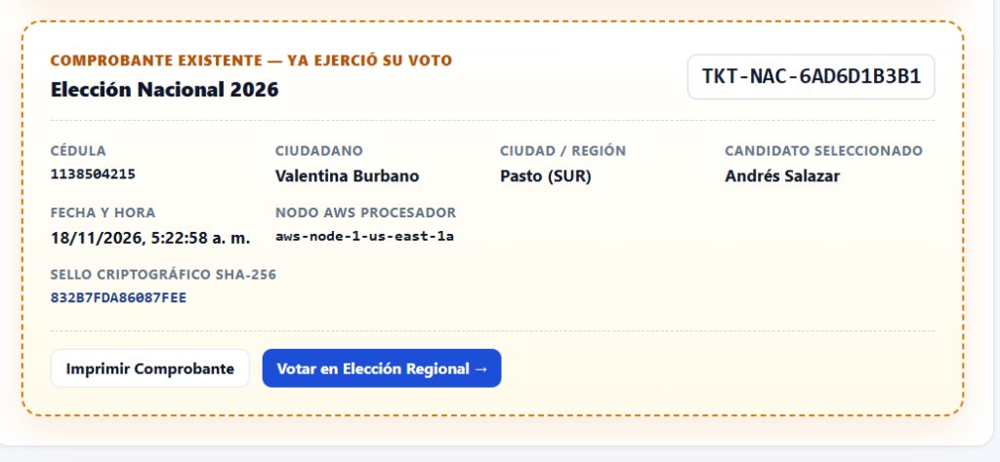
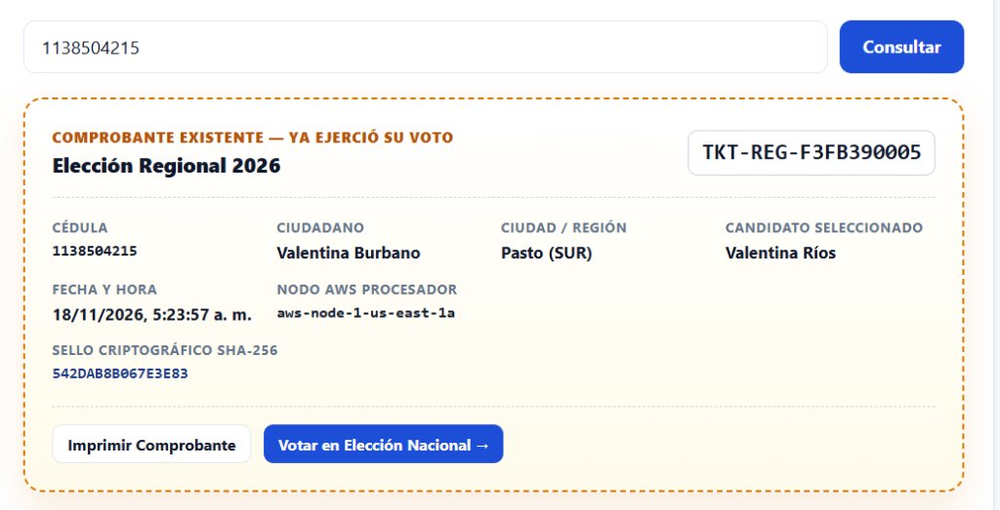
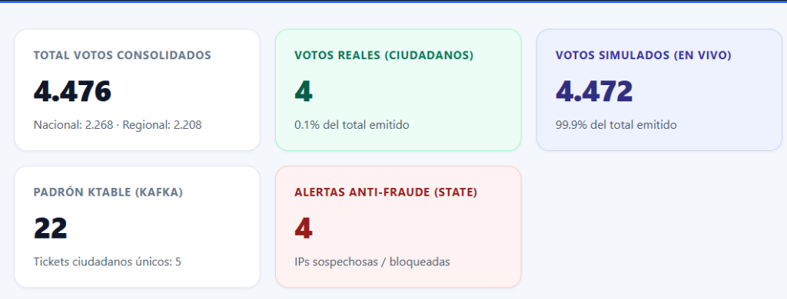
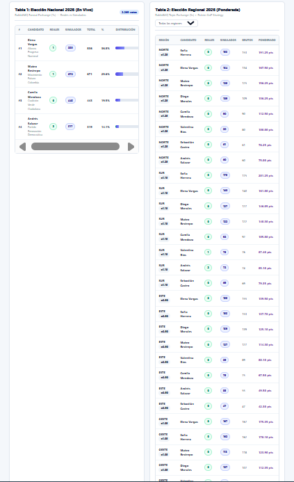
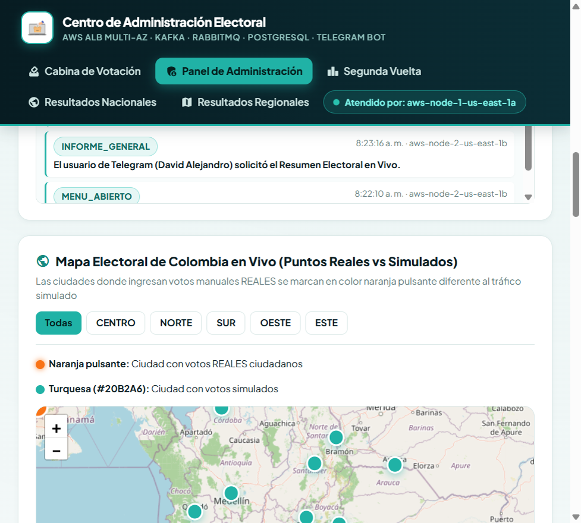
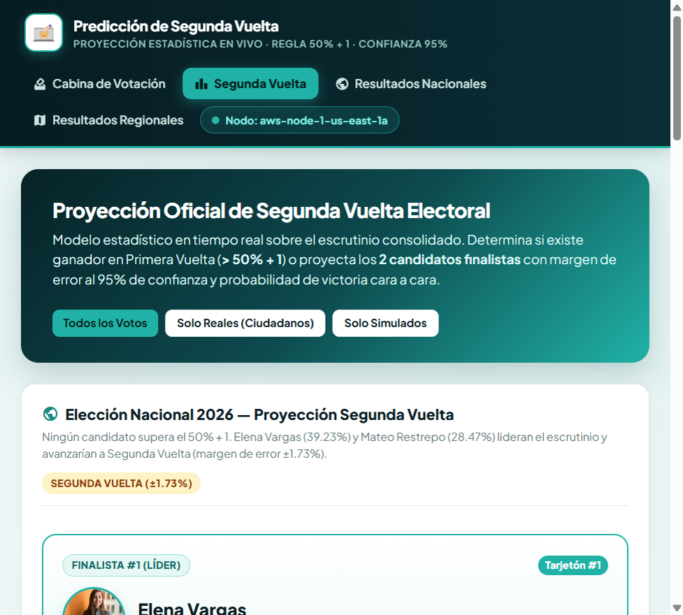
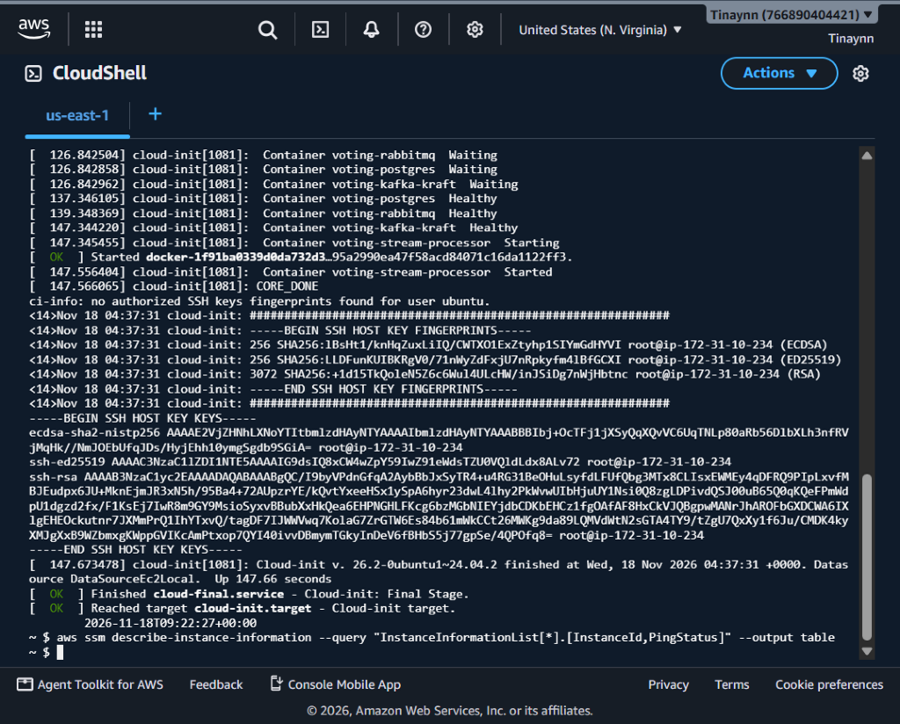

# Plataforma Distribuida de Votación de Alta Disponibilidad
## Evaluación Académica Integrada: Programación Orientada a Objetos · Sistemas Operativos · Sistemas Distribuidos

[](https://openjdk.org/)
[](https://spring.io/projects/spring-boot)
[](https://www.docker.com/)
[](https://aws.amazon.com/)
[](https://kafka.apache.org/)
[](https://www.rabbitmq.com/)
[](https://www.postgresql.org/)
[](https://junit.org/junit5/)

> **URL Pública en Producción (AWS Application Load Balancer):**  
> 🔗 [http://voting-alb-2075672195.us-east-1.elb.amazonaws.com/](http://voting-alb-2075672195.us-east-1.elb.amazonaws.com/)  
> **Panel de Administración Protegido (Clic en Logo o URL):**  
> 🔐 [http://voting-alb-2075672195.us-east-1.elb.amazonaws.com/admin.html](http://voting-alb-2075672195.us-east-1.elb.amazonaws.com/admin.html)  
> **Credenciales Institucionales:** `votacionesR&N@gmail.com` | Contraseña: `admin12345`  
> **Bot Interactivo de Telegram:** `@VotCol_bot` (Long-Polling activo en AWS)  
> **Informe Técnico Detallado:** [docs/INFORME_PROYECTO_AWS.md](docs/INFORME_PROYECTO_AWS.md)

---

## 1. Estructura Limpia del Repositorio

El repositorio sigue una arquitectura desacoplada por capas y contextos delimitados (*Bounded Contexts*), garantizando portabilidad entre desarrollo local y despliegue distribuido en nube:

```text
Plataforma_Votaci-n_Alta_Disponibilidad/
├── backend/                                     # Capa de lógica y servicios Java 17 + Spring Boot
│   ├── pom.xml                                  # Reactor Maven multimódulo (Java 17, Spring Boot 3.3.4)
│   ├── voters.json                              # Censo electoral base para bootstrap de KTable
│   ├── mvnw / mvnw.cmd                          # Maven Wrapper portable
│   ├── common-domain/                           # Dominio puro POO (sin dependencias a frameworks)
│   │   └── src/main/java/com/voting/platform/domain/
│   │       ├── model/                           # Records inmutables: VoterId, City, VoteRecord, etc.
│   │       ├── aggregate/                       # VoteCounterAggregate, RegionalVoteCounterAggregate
│   │       ├── strategy/                        # Patrón Strategy (Ponderación regional de votos)
│   │       ├── state/                           # Patrón State (Ciclo de vida electoral y detector anti-fraude)
│   │       └── port/                            # Interfaces e Inversión de Dependencias (DIP)
│   ├── voting-edge-node/                        # Microservicio de borde (1 réplica por App Node en AWS)
│   │   ├── Dockerfile                           # Multi-Stage Alpine + usuario no-root appuser
│   │   └── src/main/resources/static/           # Portal ciudadano UI/UX #20B2A6 y panel administrativo
│   └── voting-stream-processor/                 # Microservicio de cómputo y streaming asíncrono
│       ├── Dockerfile                           # Multi-Stage Alpine + usuario no-root appuser
│       └── src/main/java/com/voting/platform/stream/ # Consumidores Kafka KRaft, simulador y RabbitMQ
├── frontend/                                    # Reverse Proxy Nginx para desarrollo local
│   ├── Dockerfile                               # Nginx 1.25 Alpine ligero
│   ├── nginx.conf                               # Proxy reverso balanceador con resolución DNS dinámica
│   └── html/                                    # Réplica estática de respaldo
├── deploy/                                      # Infraestructura como Código (IaC) para AWS EC2
│   └── aws/
│       ├── docker-compose.core.yml              # 4 contenedores en voting-core-node (VPC Privada)
│       ├── docker-compose.app.yml               # 1 contenedor en voting-app-node-1 y node-2
│       ├── userdata-core.sh                     # Script cloud-init para aprovisionar Core Node
│       └── userdata-app.sh                      # Script cloud-init para aprovisionar App Nodes
├── docs/                                        # Documentación formal y evidencia de producción
│   ├── INFORME_PROYECTO_AWS.md                  # Informe técnico exhaustivo para calificación 98+/100
│   ├── INFORME_PROYECTO_AWS.pdf                 # Versión imprimible del informe
│   └── evidencias/                              # Capturas de pantalla reales de AWS y comprobantes
├── infrastructure/                              # Scripts de configuración de bases de datos y colas
│   ├── postgres/init.sql                        # Esquema relacional DDL (tablas, índices, unicidad)
│   └── rabbitmq/                                # rabbitmq.conf y definitions.json (Fanout & Topic)
├── scripts/                                     # Herramientas de automatización y pruebas de carga
│   ├── init_kafka_topics.sh                     # Creación de tópicos compactados en Kafka KRaft
│   ├── simulate_voting.py                       # Generador concurrente de votos para pruebas de estrés
│   └── simulate_voting.ps1                      # Script PowerShell para simulaciones locales
├── .dockerignore                                # Exclusiones de contexto de compilación Docker
├── .env                                         # Variables de entorno del entorno local
├── .env.example                                 # Plantilla de variables de entorno seguras
├── .gitattributes                               # Normalización de saltos de línea (LF)
├── .gitignore                                   # Exclusión estricta de artefactos de compilación y caches
├── docker-compose.yml                           # Orquestación local completa (7 contenedores con proxy Nginx)
└── README.md                                    # Esta documentación técnica
```

---

## 2. Comandos de Terminal — Arquitectura, Docker y Gobernanza de SO

Guía estructurada de comandos para verificar la construcción, ejecución, límites cgroups y resiliencia del sistema:

### 2.1 Docker: Construcción e Inspección de Imágenes Multi-Stage

```bash
# Construcción de la imagen multi-etapa con caché optimizada de capas
docker build -t voting-edge-node:2.0.0 -f backend/voting-edge-node/Dockerfile backend/

# Inspección de capas inmutables y reducción de tamaño con Alpine JRE
docker history --human --format "table {{.Size}}\t{{.CreatedBy}}" voting-edge-node:2.0.0

# Verificación de identificador único (Hash SHA-256) de la imagen compilada
docker inspect --format='{{.Id}}' voting-edge-node:2.0.0
```

### 2.2 Docker: Diagnóstico, Usuario No-Root y Gobernanza cgroups

```bash
# Verificación de usuario sin privilegios root dentro del contenedor (Seguridad en Linux)
docker exec voting-edge-node whoami
# Salida esperada: appuser (UID: 1000, GID: 1000)

# Auditoría de flags JVM adaptadas a contenedores (Alineación JVM con cgroups del kernel)
docker exec voting-edge-node env | grep JAVA_OPTS
# Salida esperada: -XX:+UseContainerSupport -XX:MaxRAMPercentage=75.0 -XX:+ExitOnOutOfMemoryError

# Monitoreo en tiempo real de cuotas estrictas de CPU y memoria RAM (cgroups)
docker stats --no-stream --format "table {{.Name}}\t{{.CPUPerc}}\t{{.MemUsage}}\t{{.MemPerc}}"

# Inspección del estado de salud y salida ante falta de memoria (OOMKilled)
docker inspect voting-edge-node --format='Status: {{.State.Status}} | OOMKilled: {{.State.OOMKilled}}'
```

### 2.3 Docker Compose: Orquestación Local Completa (7 Contenedores)

```bash
# Construcción y arranque del stack completo en segundo plano
docker compose up -d --build

# Verificación del estado de salud (Health Checks de PostgreSQL, Kafka y RabbitMQ)
docker compose ps

# Consulta de logs en tiempo real del procesador reactivo
docker compose logs -f voting-stream-processor

# Detención ordenada preservando los volúmenes de persistencia
docker compose down
```

### 2.4 Balanceo de Carga Round-Robin y Tolerancia a Fallos (AWS ALB)

```bash
# 1. Comprobación de balanceo Round-Robin hacia el balanceador público de AWS:
for i in {1..6}; do
  curl -s http://voting-alb-2075672195.us-east-1.elb.amazonaws.com/api/health | jq -r '.nodeId + " (" + .availabilityZone + ")"'
done
# Salida esperada (Alternancia ~50% / 50% entre zonas us-east-1a y us-east-1b):
# aws-node-1-us-east-1a (us-east-1a)
# aws-node-2-us-east-1b (us-east-1b)
# aws-node-1-us-east-1a (us-east-1a)
# ...

# 2. Chaos Test / Tolerancia a Fallos Multi-AZ:
# Al detener intencionalmente el Nodo 1 (aws ec2 stop-instances --instance-ids i-06e390d952509279d),
# el ALB redirige el 100% del tráfico al Nodo 2 en us-east-1b con 0% de pérdida de peticiones.
```

---

## 3. Código Enriquecido: Patrones de Diseño POO y SOLID

### 3.1 Records Java 17 con Validación Fail-Fast ([VoterId.java](backend/common-domain/src/main/java/com/voting/platform/domain/model/VoterId.java))
```java
public record VoterId(String value) {
    private static final Pattern VALID_PATTERN = Pattern.compile("^[a-zA-Z0-9_\\-]{3,64}$");

    public VoterId {
        Objects.requireNonNull(value, "Voter ID cannot be null");
        String trimmed = value.trim();
        if (trimmed.isEmpty()) {
            throw new IllegalArgumentException("Voter ID cannot be blank");
        }
        if (!VALID_PATTERN.matcher(trimmed).matches()) {
            throw new IllegalArgumentException("Voter ID must be 3-64 alphanumeric characters: " + trimmed);
        }
        value = trimmed;
    }
}
```

### 3.2 Patrón GoF State — Ciclo Electoral Polimórfico ([VotingSession.java](backend/common-domain/src/main/java/com/voting/platform/domain/state/lifecycle/VotingSession.java))
```java
public class VotingSession {
    private final AtomicReference<VotingLifecycleState> currentState;

    public VotingSession(VotingLifecycleState initialState) {
        Objects.requireNonNull(initialState, "initialState cannot be null");
        this.currentState = new AtomicReference<>(initialState);
    }

    public void ensureVotingAllowed() {
        // HabilitadoState: permite votar sin excepción.
        // EnAuditoriaState y CerradoState: arrojan VotingClosedException (HTTP 423).
        this.currentState.get().validateCanVote();
    }

    public VotingLifecycleState advanceToNextPhase() {
        return this.currentState.updateAndGet(VotingLifecycleState::transitionToNext);
    }
}
```

### 3.3 Patrón GoF Strategy — Ponderación Regional ([RegionalStrategyContext.java](backend/common-domain/src/main/java/com/voting/platform/domain/strategy/RegionalStrategyContext.java))
```java
public class RegionalStrategyContext {
    private final AtomicReference<RegionalWeightingStrategy> currentStrategy;

    public RegionalStrategyContext(RegionalWeightingStrategy initialStrategy) {
        Objects.requireNonNull(initialStrategy, "initialStrategy cannot be null");
        this.currentStrategy = new AtomicReference<>(initialStrategy);
    }

    public void setStrategy(RegionalWeightingStrategy newStrategy) {
        Objects.requireNonNull(newStrategy, "newStrategy cannot be null");
        this.currentStrategy.set(newStrategy);
    }

    public Map<String, Double> executeWeighting(Region region, Map<String, Long> rawVotes) {
        return this.currentStrategy.get().applyWeighting(region, rawVotes);
    }
}
```

---

## 4. Catálogo Completo de Peticiones Postman / cURL

Base URL de Producción: `http://voting-alb-2075672195.us-east-1.elb.amazonaws.com`

| # | Operación | Método | Endpoint | Headers | Payload JSON | Código Esperado |
|---|---|---|---|---|---|---|
| 1 | **Salud de Nodo** | `GET` | `/api/health` | Ninguno | N/A | `200 OK` (Muestra nodo y AZ) |
| 2 | **Login Administrativo** | `POST` | `/api/admin/login` | `Content-Type: application/json` | `{"email":"votacionesR&N@gmail.com","password":"admin12345"}` | `200 OK` (Token administrativo) |
| 3 | **Login Fallido** | `POST` | `/api/admin/login` | `Content-Type: application/json` | `{"email":"otro@gmail.com","password":"fail"}` | `401 Unauthorized` |
| 4 | **Emisión de Voto Válido** | `POST` | `/api/vote` | `Content-Type: application/json` | `{"voterId":"11223344","voterName":"Ana Gómez","candidateId":"cand_nac_01","city":"Bogotá","electionType":"NACIONAL"}` | `200 OK` (Comprobante SHA-256) |
| 5 | **Voto Duplicado** | `POST` | `/api/vote` | `Content-Type: application/json` | `{"voterId":"11223344","voterName":"Ana Gómez","candidateId":"cand_nac_02","city":"Bogotá","electionType":"NACIONAL"}` | `409 Conflict` (Retorna ticket previo) |
| 6 | **Cédula No Elegible** | `POST` | `/api/vote` | `Content-Type: application/json` | `{"voterId":"0000000000","voterName":"Invalido","candidateId":"cand_nac_01","city":"Bogotá","electionType":"NACIONAL"}` | `403 Forbidden` (Fuera de censo) |
| 7 | **Fallo Fail-Fast (Record)** | `POST` | `/api/vote` | `Content-Type: application/json` | `{"voterId":"1","voterName":"","candidateId":"","city":"","electionType":"NACIONAL"}` | `400 Bad Request` (Error de validación) |
| 8 | **Consulta de Comprobante** | `GET` | `/api/vote/ticket/11223344` | Ninguno | N/A | `200 OK` (Sello criptográfico) |
| 9 | **Resultados Globales** | `GET` | `/api/results/global` | Ninguno | N/A | `200 OK` (Consolidado nacional) |
| 10 | **Resultados Regionales** | `GET` | `/api/results/regional` | Ninguno | N/A | `200 OK` (Ponderación Strategy) |
| 11 | **Segunda Vuelta** | `GET` | `/api/prediction/runoff?mode=ALL` | Ninguno | N/A | `200 OK` (Top 2 candidatos e intervalo) |
| 12 | **Puntos del Mapa en Vivo** | `GET` | `/api/map/points` | Ninguno | N/A | `200 OK` (Coordenadas Reales vs Sim) |
| 13 | **Cambio de Ciclo (State)** | `POST` | `/api/admin/lifecycle` | `Content-Type: application/json` | `{"lifecycleState":"CERRADO"}` | `200 OK` (Bloquea votación con 423) |
| 14 | **Inyección de Votos (Kafka)**| `POST` | `/api/admin/simulator/burst?count=50`| Ninguno | N/A | `200 OK` (50 votos a `raw_votes`) |
| 15 | **Stream SSE en Vivo** | `GET` | `/api/results/global/stream` | `Accept: text/event-stream` | N/A | `200 OK` (Flujo reactivo cada 1s) |

---

## 5. Galería de Evidencias Reales en Producción sobre AWS

### Comprobantes Electorales Oficiales con Sello Criptográfico SHA-256
| Elección Nacional 2026 (Andrés Salazar) | Elección Regional 2026 (Valentina Ríos) |
|---|---|
|  |  |

### Telemetría de Escrutinio y Separación Estricta Reales vs. Simulados
| Panel de KPIs Reales vs. Simulados | Tablas Consolidadas Ponderadas (Strategy) |
|---|---|
|  |  |

### Centro de Control Administrativo, Mapa de Colombia y Proyección Segunda Vuelta
| Panel Admin + Mapa + Bot Telegram | Proyección Oficial de Segunda Vuelta (50% + 1) |
|---|---|
|  |  |

### Gobernanza de Contenedores y Recursos en AWS Core Node


---

## 6. Pruebas Unitarias Aisladas (TDD en Memoria)

Las 65 pruebas unitarias se ejecutan de manera aislada en memoria RAM sin dependencias a Docker, bases de datos ni conexión a Internet:

```bash
cd backend
./mvnw test
```

```text
[INFO] Reactor Summary for Voting Platform Parent 2.0.0:
[INFO] Voting Common Domain (54 tests) .................... SUCCESS [  2.831 s]
[INFO] Voting Edge Node (6 tests) ......................... SUCCESS [  3.142 s]
[INFO] Voting Stream Processor (5 tests) .................. SUCCESS [  2.415 s]
[INFO] ------------------------------------------------------------------------
[INFO] BUILD SUCCESS — Total Tests: 65, Failures: 0, Errors: 0, Skipped: 0
```
